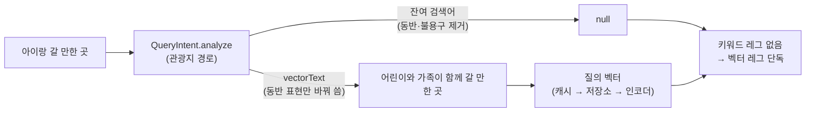

# 「아이와」를 뜻으로 읽게 하는 방법 — 동반 표현 해석

관광지 검색이 「아이랑 갈 만한 곳」을 **글자가 아니라 뜻(아이와 함께 갈 곳)** 으로 읽게 만든 방식을 코드 흐름으로 정리한다.
다른 검색(통합 검색·블로그·딜)에서 같은 문제를 풀 때 참고한다. 결정 근거는 ADR-0090 개정(2026-10-13), 요구는
`docs/specs/2026-10-13-place-search-intent-followups/spec.md`.

## 무엇이 문제였나

| 단계 | 「아이랑 갈 만한 곳」이 겪는 일 | 결과 |
|---|---|---|
| 형태소 분석(nori) | `아이 · 랑 · 가 · ㄹ · 만 · 하 · ㄴ · 곳` 으로 쪼개진다. 조사 `랑` 은 품사 필터가 지운다 | `아이` 만 내용어로 남는다 |
| BM25(키워드 검색) | `아이` 가 제목 가중치 ×3 에 맞는다 | 「아이아이 연남」·「아이와즈」·「아이러브팜핑」이 위로 |
| 벡터 검색 | 원문 문장을 그대로 임베딩한다 | **임베딩도 글자에 끌린다** — 벡터 단독 상위 10 에도 같은 상호 5곳 |

키워드에서 「아이랑」을 빼는 것만으로는 부족하다. 남은 벡터 검색이 원문 문장을 보면 같은 상호가 다시 올라온다.

## 해법 — 두 레그를 따로 다룬다

1. **키워드 레그에서 뺀다** — 동반 표현은 문서가 가진 글자가 아니라 **누구와 가는가**라는 조건이다. 남겨 두면 BM25 가 상호 이름과 맞춘다.
2. **벡터 레그 문장은 뜻을 풀어 쓴 표준 문구로 바꾼다** — 「아이랑」을 「어린이와 가족이 함께」로. 임베딩 모델이 「아이」라는 글자 대신
   「어린이·가족·함께」라는 뜻으로 이웃을 찾는다. 나머지 어절(「갈 만한 곳」·「해수욕장」)은 원문 그대로 둔다.
3. **필터·조건은 그대로 읽는다** — 「애들이랑 같이 해수욕장」은 동반 표현 + 분류 필터(해수욕장)로 갈린다. 벡터 문장은
   「어린이와 가족이 함께 해수욕장」, 분류 필터는 두 레그에 같이 걸린다.

## 코드 위치

| 하는 일 | 위치 |
|---|---|
| 동반 표현 찾기 · 표준 문구로 바꾼 문장 만들기 | `search/domain/.../query/model/QueryIntent.kt` `extractCompanion` · `Understood.vectorText` |
| 벡터 인코딩에 바꾼 문장 쓰기 | `search/app/.../attraction/service/SearchAttractionService.kt` `resolveEmbedding(understood?.vectorText ?: keyword, …)` |
| 잔여가 없을 때 벡터 레그 단독 | `search/app/.../opensearch/AttractionSearchAdapter.kt` `buildRequest` 의 `query.keyword == null` 분기 |
| 바꾼 문장의 벡터 보관 | `QueryVectorService.resolve` — 처음 한 번 인코더를 부르고 저장소·캐시에 남긴다(바꾼 문장이 키) |

## 무엇을 동반 표현으로 보나

| 형태 | 예 | 옮기나 |
|---|---|---|
| 머리말 + 조사 한 어절 | 아이랑 · 아이와 · 애들이랑 · 아기랑 · 가족과 · 자녀와함께 | ✓ |
| 머리말 + 「함께·같이·동반·데리고」 | 아이 동반 · 어린이 함께 | ✓ (두 어절) |
| 위 형태 + 뒤따르는 「같이·함께」 | 애들이랑 같이 | ✓ (두 어절) |
| 영문 두 어절 이하 | with kids · for kids · kid friendly · family friendly | ✓ (표준 문구 `family friendly for kids`) |
| 머리말만 | 어린이 박물관 · 키즈카페 | ✗ — 그 시설을 찾는 말이다 |
| 조사가 아닌 꼬리 | 아이와즈 · 아이러브 | ✗ — 상호다 |
| 통합 검색 경로 | (같은 질의) | ✗ — 잔여가 블로그·게임 검색으로 넘어가 그 결과가 바뀐다 |

## 다른 곳에 적용할 때

- **실측 먼저.** 표준 문구는 직감으로 고르지 않는다. 운영 인코더로 후보 문장 3~5개를 벡터 단독으로 돌려 상위 10 을 비교했다
  (2026-10-13: 「아이와 함께 가기 좋은 곳」 · 「어린이와 가족이 함께 가기 좋은 곳」 · 「어린이 가족 나들이 체험 장소」 중 둘째가
  상호를 가장 적게 끌었다). 같은 비교를 그 도메인 색인으로 다시 한다.
- **바꿔 쓰는 범위를 좁게 둔다.** 「벡터에는 원문」이 기본이다(ADR-0090) — 원문 뜻을 잘 잡는 질의를 바꾸면 그쪽이 나빠진다.
  예외는 「글자가 상호·이름과 겹쳐 임베딩이 끌리는」 것이 실측으로 보인 표현만.
- **판정 세트로 확인한다.** 바꾼 뒤 nDCG 와 「바뀐 질의 top-5」를 함께 본다. 이 표현은 판정 세트 NATURAL 유형
  「아이랑 갈 만한 곳」이 기준이다.
- **조건과 섞지 않는다.** 동반 표현은 속성 필터가 아니다 — 원천에 「아이 동반 가능」 칸이 없다. 필터로 옮기면 0건이 되거나
  유모차 대여처럼 다른 뜻의 칸에 기대게 된다.

## 배포 뒤 실측 (2026-10-13 04:46 KST, search `5a28c1c`)

| 질의 | 이전 top-5 | 이후 top-5 |
|---|---|---|
| 아이랑 갈 만한 곳 | 아이아이 연남 · 아이와즈 · 아이러브팜핑 · 밀양 우리아이마음숲놀이터 · 아이뜰 관광 농원 | 임내숲 어린이공원 · 가막들공원 · 아빠랑놀자 키즈글램핑 · 안성맞춤가족공원 · 모산공원 |
| 아이와 갈만한 곳 | 아이아이 연남 · 아이와즈 · 와글아이 · 밀양 우리아이마음숲놀이터 · 포레스트벨 | 임내숲 어린이공원 · 가막들공원 · 모산공원 · 아빠랑놀자 키즈글램핑 · 안성맞춤가족공원 |

판정 세트 v3(10-11) 두 바퀴째 top-10 nDCG, 바뀐 질의의 새 문서 30쌍은 같은 기준·같은 채점 모델로 블라인드 보강 채점 뒤:

| 질의 | nDCG 변화 |
|---|---|
| 아이랑 갈 만한 곳 | +0.60 |
| 아이와 갈만한 곳 | +0.41 |
| 유아와 갈만한 곳 | +0.02 |
| kids-friendly place | +0.03 |
| kids friendly place | −0.17 (아동복 매장 3곳이 상위에 — 「kids」 글자가 영문 상호에 맞는다) |

국문 C 0.7360 → 0.7438, 영문 C 0.7219 → 0.7441(영문은 오타 교정 하한 효과 포함).

> [!warning] 보강 채점 없이 재면 반대로 보인다
> 판정 세트는 옛 결과로 풀링해 만들었으므로 새로 올라온 어린이공원은 등급이 없어 0점이 된다. 보강 전 계산은
> 「아이랑 갈 만한 곳」 −0.21 · 「유아와 갈만한 곳」 −0.78 · 국문 C −0.0069 였다. 결과 집합을 바꾸는 변경은 바뀐 질의의
> top-10 에서 판정 없는 문서 수부터 세고, 있으면 채점한 뒤 비교한다.
