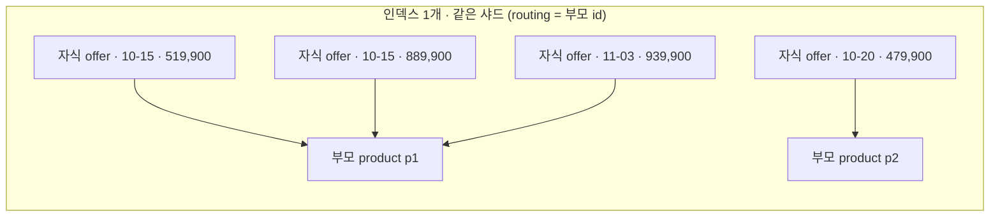

join 필드로 한 인덱스 안의 문서끼리 부모-자식 관계를 맺고 조회하는 방법을 다룬다. OpenSearch 3.5 · 3.7, Elasticsearch 7.x 기준이다.

| 항목 | 답 |
|---|---|
| 쓰는 곳 | 부모 하나에 자식이 아주 많고, 자식이 자주 바뀌는 일대다 |
| 핵심 쿼리 | `has_child` · `has_parent` · `parent_id` |
| 핵심 제약 | 인덱스당 join 필드 1개, 부모·자식이 같은 샤드 (routing 필수) |
| 대가 | nested 보다 조회가 느리고, 갱신은 싸다 |
| 지원 | ES 6.x 이상, OpenSearch 1.x ~ 3.x 전부 기본 모듈 |

## parent-join 은 무엇인가

부모와 자식은 각각 독립된 문서다. 자식은 join 필드에 부모 id 를 적고, 부모 id 로 routing 해 같은 샤드에 놓인다.



- 자식 하나를 고쳐도 부모와 다른 자식은 다시 쓰지 않는다.
- 결과 단위는 쿼리가 고른다. `has_child` 는 부모를, `has_parent` 는 자식을 돌려준다.
- 관계는 같은 인덱스·같은 샤드 안에서만 성립한다.

| | parent-join | nested | SQL JOIN | 별칭 여러 인덱스 |
|---|---|---|---|---|
| 저장 | 부모·자식 별도 문서 | 부모 문서 안의 숨은 블록 | — | 인덱스별 문서 |
| 관계 | 자식 → 부모 id | 블록 안 위치 | 질의 시 임의 조건 | 없음 (합집합) |
| 자식 1건 수정 | 자식 문서만 | 부모 문서 전체 재색인 | — | — |
| 조건 맞는 하위가 있는 상위 | `has_child` | `nested` 쿼리 | JOIN + WHERE | 불가 |
| 쓰는 방법 | Query DSL | Query DSL | SQL 플러그인 | 인덱스 이름 대신 별칭 |

## 어느 버전에서 되나

| 엔진 | 상태 | 비고 |
|---|---|---|
| Elasticsearch 6.x | <span class="pill p-green">지원</span> | 매핑 타입이 하나로 줄며 `_parent` 대신 `join` 필드가 표준이 됐다 |
| Elasticsearch 7.x | <span class="pill p-green">지원</span> | 기본 배포에 `parent-join` 모듈 포함 |
| Elasticsearch SQL 7.x | <span class="pill p-red">JOIN 미지원</span> | SQL 문법의 JOIN 이 없는 것이고, Query DSL 의 parent-join 과는 별개다 |
| OpenSearch 1.x ~ 3.x | <span class="pill p-green">지원</span> | ES 7.10.2 에서 갈라져 `parent-join` 모듈을 그대로 가진다 |
| OpenSearch 3.5 관리형 | <span class="pill p-green">지원</span> | 이 글의 매핑·쿼리·정렬·집계·별칭 예시의 기준 버전 |
| OpenSearch 3.7 관리형 | <span class="pill p-green">모듈 있음</span> | `GET _nodes/_local` 의 modules 에 `parent-join` |

> [!TIP]
> 호환 모드가 켜진 OpenSearch 도메인은 `GET /` 가 7.10.2 로 보인다. 실제 버전은 nodes API 로 본다.

## 매핑과 규칙

```json
PUT catalog
{ "mappings": { "properties": {
    "doc_rel": { "type": "join",
      "relations": { "product": "offer" } },
    "title": { "type": "text" },
    "offer": { "properties": {
      "date":  { "type": "date" },
      "city":  { "type": "keyword" },
      "title": { "type": "text" },
      "price": { "type": "long" } } } } } }
```

자식이 여러 종이면 배열로, 여러 단계면 relation 을 이어 적는다.

```json
"relations": { "product": ["offer", "review"] }

"relations": { "product": "offer", "offer": "seat" }
```

| 규칙 | 의미 |
|---|---|
| 인덱스당 join 필드 1개 | 관계가 여러 개면 한 join 필드의 `relations` 안에 모두 적는다 |
| 자식의 부모는 하나 | 자식 문서는 부모 id 를 하나만 가진다 |
| 부모 역할 문서에만 자식 추가 | relations 에서 부모인 이름으로 색인된 문서만 자식을 가진다 |
| 관계 추가는 가능 | 새 relation 추가는 된다. 기존 관계 삭제·변경은 재색인 대상이다 |
| 단계는 적게 | 단계마다 조인이 하나씩 늘어난다. 중간 단계 값은 자식에 복제하는 편이 대개 싸다 |
| 필드 이름 분리 | 같은 필드 이름을 쓰면 BM25 통계가 섞인다. 자식 필드는 `offer.*` 처럼 접두어로 나눈다 |
| global ordinals | 부모 id 의 global ordinals 로 조인한다. 부모가 많을수록 refresh 비용과 힙이 커진다 |

## 색인 — 자식은 routing 필수

```json
PUT catalog/_doc/p1
{ "doc_rel": "product", "title": "해변 자유여행 5일" }

PUT catalog/_doc/o1?routing=p1
{ "doc_rel": { "name": "offer", "parent": "p1" },
  "offer": { "date": "2026-10-15", "city": "A",
             "title": "해변 자유여행 5일 (리조트 X)", "price": 519900 } }
```

bulk 에서는 action 줄에 routing 을 넣는다. 부모 삭제는 자식으로 번지지 않으므로 자식을 따로 지운다.

```json
{ "index": { "_id": "o2", "routing": "p1" } }
{ "doc_rel": { "name": "offer", "parent": "p1" }, "offer": { } }

POST catalog/_delete_by_query?routing=p1
{ "query": { "parent_id": { "type": "offer", "id": "p1" } } }
```

- routing 은 자식의 색인·GET·수정·삭제 모두에 필요하다. 샤드가 하나여도 빠지면 `mapper_parsing_exception` 으로 거부된다.
- 부모를 지워도 자식은 남는다. `has_child` 결과엔 안 나오지만 저장 공간과 자식 대상 조회에 남는다.
- 자식을 부모보다 먼저 색인해도 된다. 참조 무결성 검사는 없다.
- 자식 집합을 갈아 끼울 때는 새 자식 upsert → 사라진 자식 삭제 순서다. 반대면 자식이 0건인 순간이 생긴다.

## has_child · has_parent · parent_id

`has_child` 는 조건 맞는 자식이 있는 부모를 돌려준다.

```json
GET catalog/_search
{ "query": { "has_child": {
    "type": "offer",
    "query": { "bool": { "filter": [
      { "range": { "offer.date": { "gte": "2026-10-01", "lte": "2026-10-31" } } },
      { "match_phrase": { "offer.title": "리조트 X" } } ] } },
    "score_mode": "none",
    "inner_hits": { "size": 1, "sort": [ { "offer.price": "asc" } ] } } } }
```

| 파라미터 | 필수 | 값 · 기본값 | 설명 |
|---|---|---|---|
| `type` | 예 | 자식 relation 이름 | 어느 자식 종류를 볼지 |
| `query` | 예 | 쿼리 | 자식 문서에 걸 조건 |
| `score_mode` | | `none`(기본) · `avg` · `max` · `min` · `sum` | 매칭 자식 점수를 부모 점수로 합치는 방법 |
| `min_children` · `max_children` | | 정수 | 매칭 자식 수가 범위 안인 부모만 |
| `ignore_unmapped` | | `false` | relation 이 없는 인덱스에서 오류 대신 0건 |
| `inner_hits` | | 객체 | 매칭 자식을 함께 반환 (size·sort·_source) |

> [!IMPORTANT]
> 같은 자식 AND — 조건을 한 `has_child` 의 bool 안에 넣어야 "한 자식이 모두 만족"이 된다.
> `has_child` 를 조건마다 따로 두면 조건별로 서로 다른 자식이 만족해도 부모가 걸린다. nested 쿼리도 규칙이 같다.

`has_parent` 는 조건 맞는 부모의 자식을, `parent_id` 는 특정 부모의 자식을 돌려준다.

```json
GET catalog/_search
{ "query": { "has_parent": {
    "parent_type": "product",
    "query": { "match": { "title": "자유여행" } },
    "score": false } } }

GET catalog/_search
{ "query": { "parent_id": { "type": "offer", "id": "p1" } } }
```

| 쿼리 | 파라미터 | 쓰임 |
|---|---|---|
| `has_parent` | `parent_type`·`query` 필수, `score`(기본 `false`), `ignore_unmapped`, `inner_hits` | 부모 조건으로 자식 거르기. inner_hits 는 부모를 반환 |
| `parent_id` | `type`·`id` 필수, `ignore_unmapped` | 한 부모의 자식 목록, 자식 일괄 삭제, 고아 자식 점검 |

## 자식 값으로 부모 정렬하기

`has_child` 결과는 자식 필드로 일반 `sort` 를 걸 수 없다. 자식 점수를 필드 값으로 바꾸고 `score_mode` 로 모은 뒤 `_score` 로 정렬한다.

```json
GET catalog/_search
{ "query": { "has_child": {
    "type": "offer",
    "score_mode": "min",
    "query": { "function_score": {
      "query": { "range": { "offer.date": { "gte": "2026-10-01", "lte": "2026-10-31" } } },
      "functions": [ { "field_value_factor": { "field": "offer.price" } } ],
      "boost_mode": "replace" } } } },
  "sort": [ { "_score": "asc" }, { "_id": "asc" } ] }
```

- 최저값은 `min`, 최고값은 `max`, 합계는 `sum`. 날짜는 epoch 로 바꾸는 `script_score` 를 쓴다.
- 점수 자리를 정렬 키로 쓰므로 그 요청에서는 관련도 점수를 같이 못 쓴다. 동률 기준은 두 번째 sort 키로 둔다.
- 점수는 float 이라 약 1,677만(2^24)을 넘는 값은 1 단위 정밀도가 사라진다.
- 카드에 보여 줄 자식은 같은 조건의 `inner_hits` 를 같은 기준으로 정렬해 받는다.

## children · parent 집계

```json
"aggs": { "offers": {
  "children": { "type": "offer" },
  "aggs": { "by_city": {
    "terms": { "field": "offer.city" },
    "aggs": { "products": { "parent": { "type": "offer" } } } } } } }
```

| 집계 | 방향 | 버킷의 doc_count |
|---|---|---|
| `children` | 부모 버킷 → 자식 | 쿼리에 걸린 부모들의 자식 수 |
| `parent` (`type` 은 자식 relation 이름) | 자식 버킷 → 부모 | 자식 값별 부모 수. nested 의 `reverse_nested` 자리 |

쿼리가 부모를 고르면 집계도 그 부모들 기준이다. 자식 쪽에 필터를 더 걸려면 `children` 아래 `filter` 집계를 둔다.

## 부모만 보이게 하는 필터드 별칭

한 인덱스에 두 종류 문서가 있어 부모 건수·`must_not`·부모 필드 terms 집계에 자식이 섞인다. 쿼리마다 필터를 넣으면 한 곳만 빠져도 섞이므로 읽기 별칭에서 강제한다.

```json
POST _aliases
{ "actions": [ { "add": {
    "index": "catalog_v1", "alias": "catalog",
    "filter": { "term": { "doc_rel": "product" } } } } ] }
```

- 별칭 필터는 최상위 결과에만 걸린다. 별칭으로 검색해도 `has_child`·`children` 는 자식을 정상적으로 본다.
- 자식을 직접 보는 운영 쿼리(`parent_id`, 고아 점검)는 인덱스 이름이나 별도 별칭으로 한다.

## nested 와 무엇이 다른가

| | nested | parent-join |
|---|---|---|
| 하위 1건 변경 | 부모 문서 전체 재색인 <span class="pill p-red">비쌈</span> | 자식 문서 1건 <span class="pill p-green">쌈</span> |
| 하위 개수 한도 | 문서당 `index.mapping.nested_objects.limit` (기본 10,000) | 없음 |
| 조회 속도 | 블록이 붙어 있어 <span class="pill p-green">빠름</span> | global ordinals 조인 <span class="pill p-amber">느림</span> |
| 하위 필드 정렬 | nested sort (필터·MIN/MAX) | 점수 정렬 (`score_mode` + function_score) |
| 상위로 되돌아가는 집계 | `reverse_nested` | `parent` |
| 하위 반환 | nested inner_hits | has_child inner_hits |
| 배치 제약 | 없음 | 같은 샤드 (routing), 인덱스당 join 1개 |
| 맞는 경우 | 하위가 적고 거의 안 바뀜 | 하위가 많고 자주 바뀜 |

두 방식 모두 결과 단위(부모)와 부모 필드의 BM25 를 그대로 둔다. 하위를 부모에 복제해 넣는 비정규화는 조회가 가장 빠르지만, 하위 조건을 한 하위로 묶는 AND 가 깨진다.

## 운영에서 밟기 쉬운 지점

| 항목 | 증상 | 대응 |
|---|---|---|
| routing 누락 | 자식 색인 거부, GET·삭제 실패, 샤드가 여럿이면 조인 안 됨 | 자식 쓰기 경로 전부에 부모 id routing, 테스트로 강제 |
| 고아 자식 | 부모 삭제 후 자식이 남아 저장 공간·조회에 섞임 | 부모 삭제 경로에 `parent_id` delete_by_query, 고아 수 정기 점검 |
| 필드 이름 공유 | 부모 필드 BM25 통계에 자식이 섞여 랭킹 변화 | 자식 필드 접두어 분리 |
| 자식 섞임 | 부모 건수·facet 에 자식 포함 | 부모 전용 필터드 별칭 |
| 조인 비용 | 매칭 자식이 많은 넓은 조건에서 지연 증가 | 대표 쿼리로 nested 대비 p95 측정 후 도입 |
| global ordinals | refresh 마다 재구축, 부모가 많으면 힙·refresh 시간 증가 | 부모 수·refresh 간격 점검 |
| 저장 크기 | 자식마다 `_id`·`_routing`·`_source` 가 따로 있어 nested 보다 커질 수 있음 | 전환 전 같은 데이터로 크기 측정 |
| 샤드 쏠림 | routing 이 부모 id 라 큰 부모가 한 샤드에 몰림 | 부모당 자식 수 분포 확인 |
| 재색인 | 관계는 한 인덱스 안에서만 성립 | 새 인덱스 전체 색인 → 별칭 교체 |
