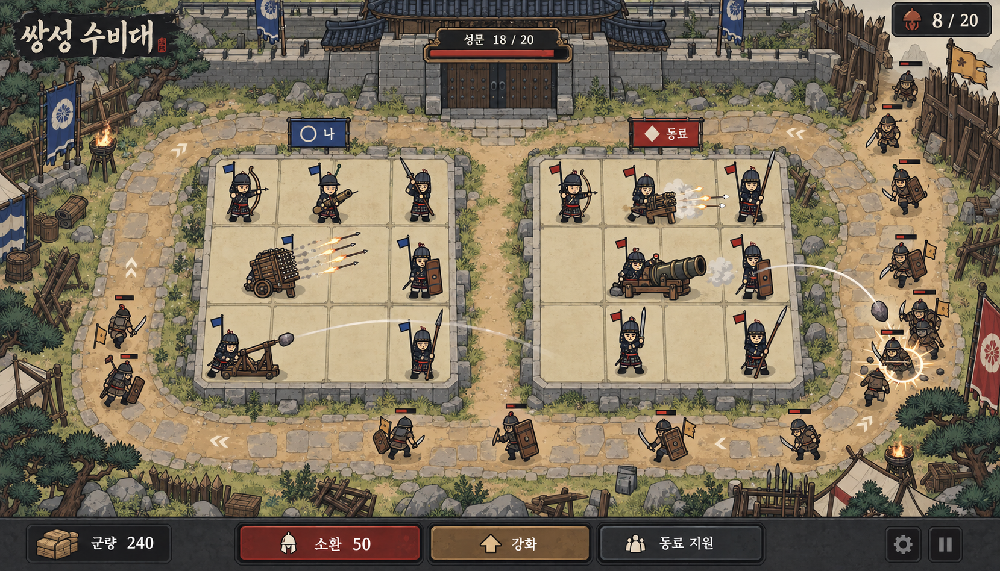
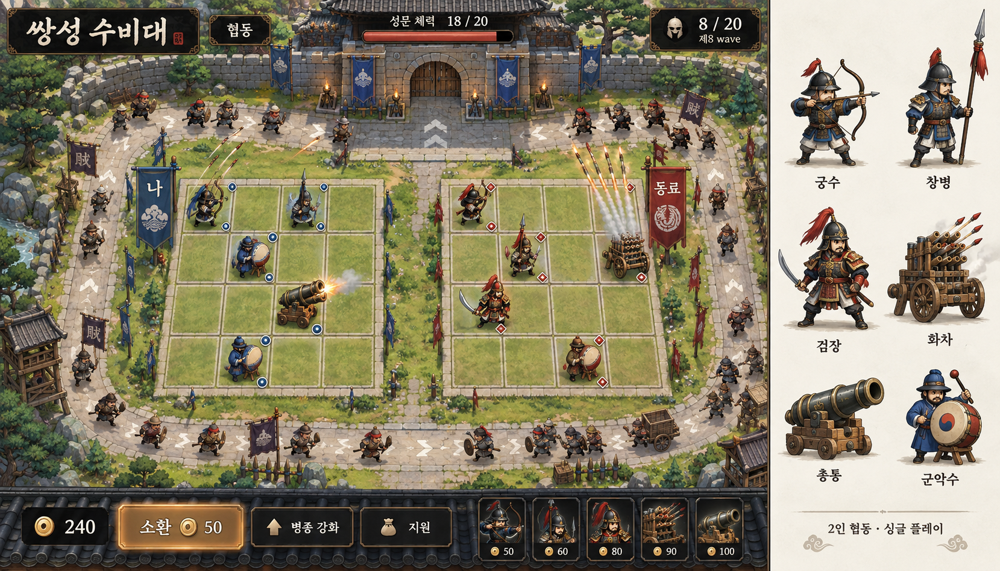
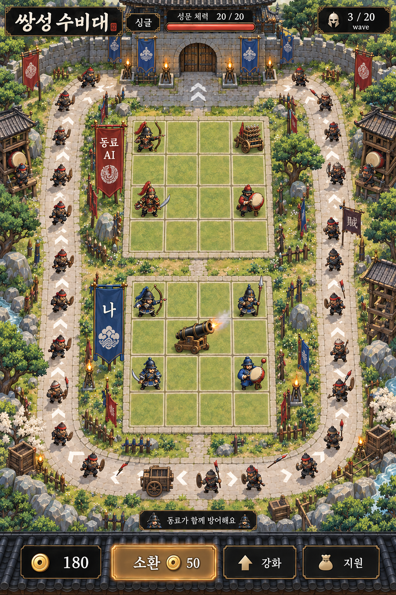

# 쌍성 수비대 — 사태 기반 수정 시안

**가칭. 2026-09-27 사용자 승인: 아래 수정 시안의 현재 캐릭터와 그래픽 그대로 개발.** 문서의 그림은 시안이며 실제 게임은 `portal-fe/public/games/twin-banner-defense/`에 별도 구현한다.

## 1. 방향

두 진영이 성문 하나를 지키는 전장. 초기 참고작은 **「사태」의 디자인과 콘셉트**이며, 최종 시각 기준은 **아래 04 수정 이미지 자체**다.
[한국 무장 공통 기준](../../design/korean-warrior.md)과 [사태 최신 원본](../2026-09-13-landslide/design/art/artboards/characters.js)을 우선한다.
긴 두정갑, 드림 달린 투구와 절제된 장식은 참고하되 등신·얼굴·먹선·명암은 승인 이미지의 실제 모습을 따른다.
사용자 최신 지시가 이전 사태 벡터 규칙보다 우선한다. 기존 SVG로 교체하거나 그래픽을 단순화하지 않는다. 무장뿐 아니라 투석기·신기전 화차·총통기를 같은 조형 언어로 배치한다.
적도 아군과 동등한 수준으로 장비와 포즈를 갖추며 단순 도형 인체는 허용하지 않는다.

### 현재 수정안 — 적·이동로·병기



돌판과 다져진 흙, 길 가장자리 단차, 잡병·방패병·중갑병의 차이, 투석기·화차·총통기 혼합 배치를 검토한다.
**시안 한계:** 생성 결과의 격자는 제안한 4×4와 일치하지 않으며 일부 발사 방향과 병기 구조도 교정이 필요하다.
이미지로 칸 수·사거리·동작을 검증했다고 주장하지 않는다. 승인한 화풍을 유지한 빈 전장과10종 아군·4종 적의84프레임 아틀라스로 분리해 구현한다. 4×4 격자와 실제 투사체는 런타임이 그린다.

## 2. 색상

루트 DESIGN.md §12의 색을 상단 토큰으로 가져왔다. 청 원형 표식은 나, 홍 마름모는 동료다.
적은 회갈색 장비·체력 막대·진행 방향으로 구별하며, 아군 홍색을 적 전용색으로 쓰지 않는다.
팀색은 인물의 깃발과 허리띠에만 적용하고 갑옷 전체를 청·홍으로 바꾸지 않는다.
추가 토큰은 사태 현재 캐릭터의 팔레트와 HUD에서 가져왔다. 게임 배경의 풀·흙·돌 명암은 일러스트 안에서 확장한다. 구현 UI에 임의의 hex 값을 추가하지 않는다.

## 3. 활자

사태의 명조 제목과 고운돋움 계열 본문을 계승한다. 기능·수치·버튼은 실제 텍스트로 렌더링한다.
생성 이미지 속 글자를 실사용 UI로 잘라 쓰지 않는다. 군량·가격에는 tabular numbers를 적용한다.

## 4. 화면과 배치

### 초기 협동 가로 시안 — 참고 기록, 현행 화풍 아님



그림의 오른쪽 병종 시트는 검토용이며 실게임 UI에 포함하지 않는다.

```text
┌───────── 성문 체력 / 현재 웨이브 ─────────┐
│                공동 성문                 │
│    ┌───────────────────────────────┐    │
│    │ 나: 4×4       동료: 4×4       │    │
│    │ 청 + 원형     홍 + 마름모     │    │
│    └───────────────────────────────┘    │
│            외곽 적 이동로                │
├─────────────────────────────────────────┤
│ 군량 │ 소환 │ 병종 강화 │ 지원 │ 편성   │
└─────────────────────────────────────────┘
```

상태는 위, 결정은 아래. 건설 영역과 적 이동로를 서로 다른 표면으로 구분한다.
장식은 가장자리에 배치하며 사거리·선택·공격 신호 위에 겹치지 않는다.
소환이 기본 행동이고, 선택 시 아래 툴바가 해당 유닛 상세로 바뀐다.

### 초기 싱글 세로 대안 — 배치 참고, 현행 화풍 아님



세로에서는 동료 AI 진영 위, 내 진영 아래로 배치하는 대안을 시각 검토한다.
각 4×4와 공용 성문은 유지한다. 단순 CSS 재배치로 전투 사거리·경로를 바꾸면 안 된다.
실제 구현 전 동일한 논리 좌표의 카메라 변환으로 처리 가능한지 검증하고, 불가능하면
기본 가로 전장 + 세로 관찰/확대 방식으로 결정한다. 그림만으로 두 레이아웃의 전투 동등성을 주장하지 않는다.

## 5. 깊이

약 65도 내려다보는 탑뷰, 축에 맞춘 사각 격자, 직교 투영. 다이아몬드형 아이소메트릭은 제외.
높이는 인물·병기·기와의 측면과 명확한 2~3단 색면으로 표현한다. 광택·그라데이션·부풀린 3D 음영을 피한다.
높은 지붕이 배치 칸을 가리지 않는다. 길은 단순 직사각 띠 대신 돌판·흙·닳은 가장자리로 표현한다.

## 6. 형태와 병종

| 병종 | 멀리서 읽히는 형태 | 게임 역할 제안 | 약점 |
|---|---|---|---|
| 궁수 | 갓, 각궁과 동개 | 긴 사거리 단일 지속 공격 | 중갑 적 |
| 포수 | 전립, 몸 옆의 총통 | 기동형 범위 사격 | 대형 병기보다 낮은 위력 |
| 검사 | 드림 달린 투구, 실용적인 환도 | 검기와 근거리 베기 | 사거리 밖 |
| 창병 | 장창, 길고 단정한 갑옷 | 직선 관통, 길가 배치 보상 | 사거리 밖 |
| 방패병 | 세로 장방패 | 진격 저지, 다른 유닛의 공격 시간 확보 | 단독 화력 |
| 투석기 | 목재 지지대, 지렛팔과 돌주머니 | 곡사·범위 타격·감속 | 긴 준비 시간 |
| 신기전 화차 | 직사각 화살 발사틀과 바퀴 | 넓은 범위 일제 사격 | 긴 재장전 |
| 총통기 | 여러 짧은 청동 총열을 묶은 틀 | 비교적 짧은 사거리의 밀집 제압 | 먼 표적 |
| 대형 총통 | 낮고 굵은 포신, 무거운 받침 | 중갑 관통, 보스 공격 | 많은 약한 적 |
| 군악수 | 둥근 북, 두 북채 | 주변 공격 속도 지원 | 단독 공격 불가 |

삼국시대~조선 병종이 함께 등장하는 시대 혼합 게임이다. 역사 고증작으로 표방하지 않는다.
특정 영웅 이름·초상은 별도 원화 단계에서 검토한다. [병기 명칭과 역사 자료](planning/weapons.md)를 따른다.
신기전기와 총통기는 다른 구조다. 투석기를 한국 독자 발명품으로 설명하지 않는다.
적은 누런 갈라진 깃발·회갈색 옷을 쓴 잡병, 넓은 장방패를 든 방패병, 둔중한 중갑병으로 구별한다.
달리기·걷기·막기·피격 포즈도 서로 다르게 만들고, 색만 다른 같은 몸체를 쓰지 않는다.

## 7. 상태

| 상태 | 보이는 변화 |
|---|---|
| 빈 칸 | 얇은 석재 경계, 소환 가능 칸 표시 |
| 선택 | 바닥 윤곽, 사거리, 병종명·등급·효과 |
| 합성 가능 | 대상 두 칸 연결, 결과 병종과 등급 미리보기 |
| 군량 부족 | 버튼 비용과 부족분 표시, 자원 변화 없음 |
| 진영 가득 참 | 소환 비활성 + 합성 안내, 자원 변화 없음 |
| 동료 지원 | 대상 진영 표식과 수신 알림 |
| AI 동료 | 이름에 AI 상시 표기, 사람으로 오인하지 않음 |
| 연결 끊김 | 재연결 상태와 정책을 명시, 몰래 초기화하지 않음 |

전투 이펙트는 화살 궤적·포탄 충격·북의 파동으로 구분한다. 선택 표시를 가리는 섬광은 제한한다.
모바일 목표는 최소 44 CSS px 터치 영역이며 생성 이미지의 픽셀 수를 접근성 검증으로 쓰지 않는다.

## 8. 시안 해석과 다음 단계

- 이미지의 240/50 군량, 8/20 웨이브, 18/20 체력은 구성 예시다. 확정 밸런스가 아니다.
- 가로 시안 아래 병종별 가격은 생성 과정의 표현이다. 제안 규칙은 소환 비용 공통이며 개별 구매가 아니다.
- 길의 정확한 출현점·회전 방향·성문 도달 조건, 근접 사거리와 지원 반경은 구현 명세에서 확정한다.
- 군악수 지원이 양 진영에 닿는지, 근접 유닛이 중앙에서 무력해지는지 먼저 검증한다.
- 원본과 프롬프트를 함께 보존했다. 이미지 시안은 내장 image_gen 도구로 생성했다.
- [사태 원본 SVG 배치 실험](artboards/03-sata-direction.html)은 구도 비교 기록이다. 사용자가 적과 길 품질을 지적했으므로 게임 아트 기준으로 채택하지 않는다.
- [수정 프롬프트](planning/visuals/04-revision-prompt.md)는 사태 v4 인물과 적·길·설치형 병기의 품질 요구를 담는다.
- 시안 선택 후 전장 타일·유닛 방향별 동작·적·발사체·UI를 별도 에셋으로 제작한다. 시안 통그림을 게임 대신 쓰지 않는다.

연결: [요구사항](planning/requirements.md), [검증 계획](planning/test-quality.md), [열린 질문](context/open-questions.yml).
