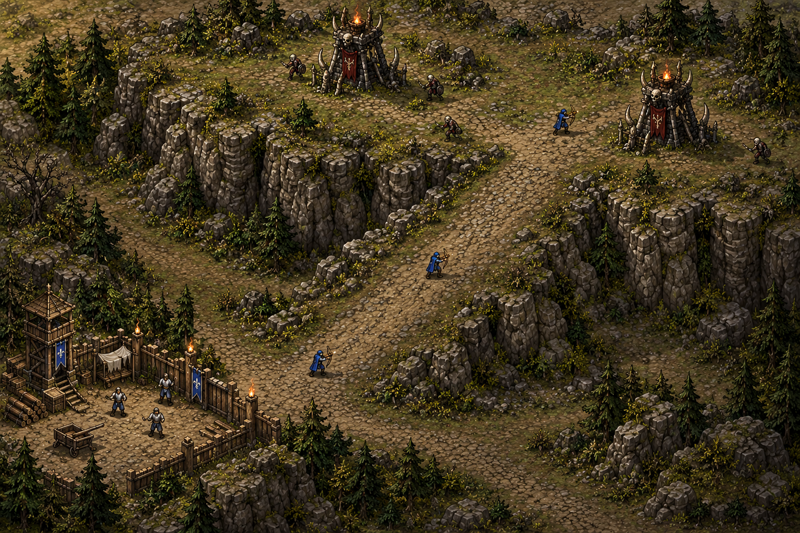
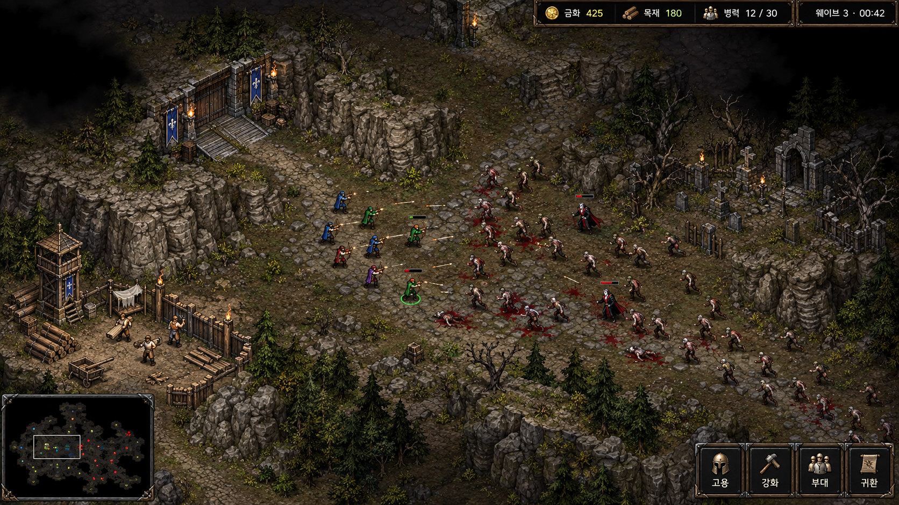
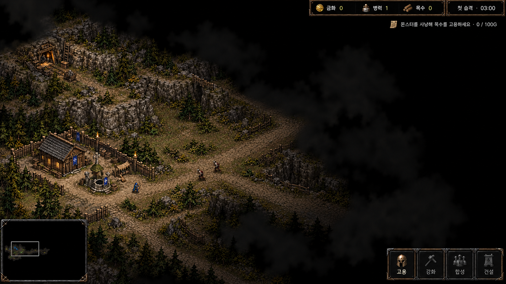
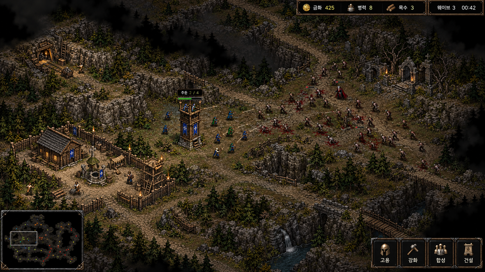
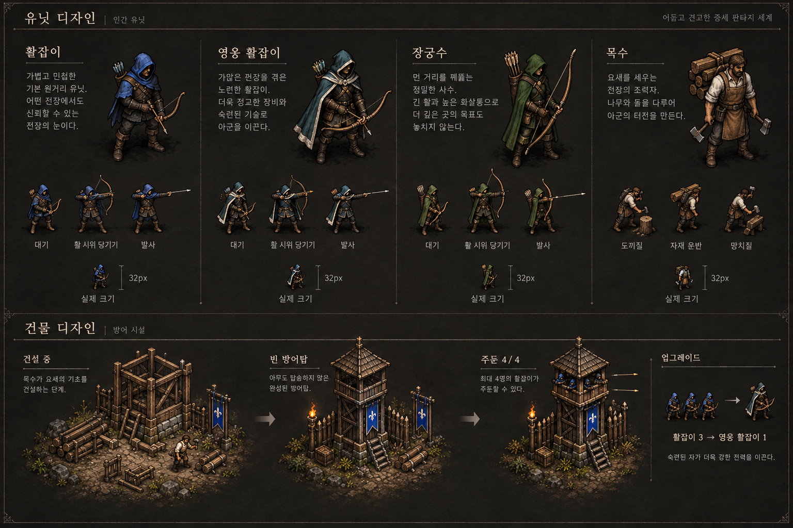
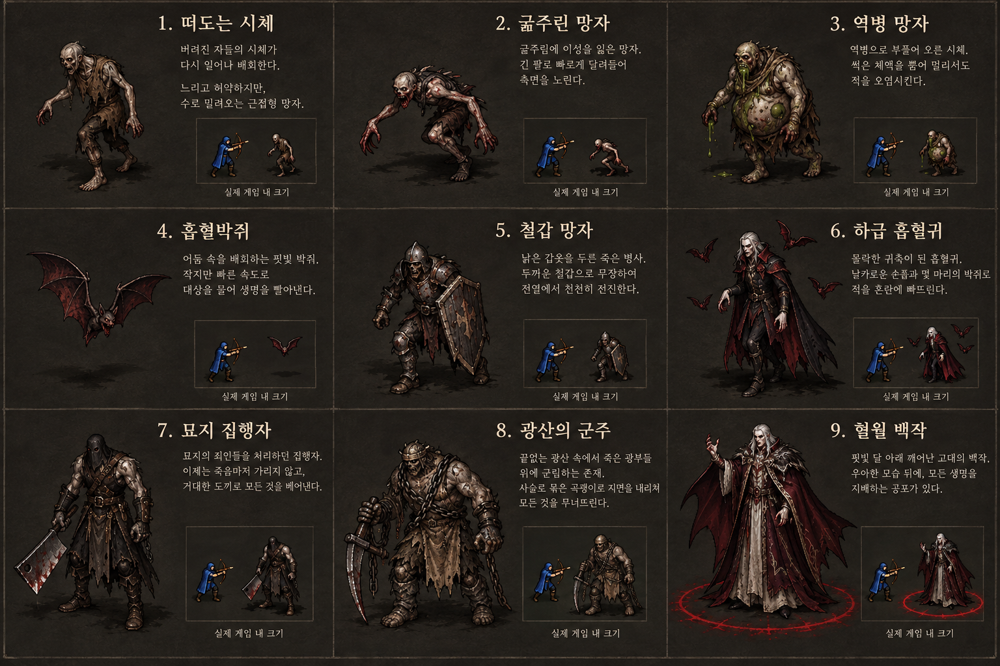

# Image concepts
**실제 게임 캡처가 아니라 imagegen으로 제작한 설계 시안.**

## 실제 사용 이미지 자산 — 2026-10-03
사용자가 도형 기반 구현의 품질 차이를 지적하여, 승인 시안05의 재질을 참조한 투명 PNG3종을 built-in image_gen으로 별도 제작했다. 아래는 실행용 개별 자산이며 실제 게임 화면 캡처가 아니다.
- `portal-fe/public/games/marine-command/assets/origin/opening-hill-v1.png`: 고지·짧은 경사로. 통행 영역에 맞춘 소스 밴드/기준점으로 렌더링.
- `portal-fe/public/games/marine-command/assets/origin/thorn-tower-v1.png`: 검은 석재·뼈·붉은 천·화로의 가시 타워.
- `portal-fe/public/games/marine-command/assets/origin/enemy-crypt-v1.png`: 같은 재질의 적 묘실.
원문 프롬프트는 `prompts/06-hill-raster.txt`, `07-tower-sprite.txt`, `08-crypt-sprite.txt`. 원본 PNG를 보존하며 생성 시안을 게임 전체 배경 한 장으로 붙이지 않는다.

## 고지·경사로 수정 시안 — 2026-10-03, 사용자 확인 대기

저지대→넓은 경사로→고지 윗면의 연속성, 밝은 윗면/어두운 절벽 단면과 접지 그림자로 높이를 표현한다. 활잡이3명은 높이 단계 설명용이며 시작 병력 변경이 아니다. 주변 인물·시설은 분위기 참고이며 신규 구현 범위가 아니다. 게임 코드 미변경. 프랙탈 생성은 보류한다.
built-in image_gen, 승인 톤00 참조. 원문 프롬프트: prompts/05-hill-ramp.txt. 사용자 확인 후 시작 구간에만 적용한다. 작업 원칙: ../context/iteration-policy.md.

## 사용자 승인 미술 톤

원화톤만 승인. 당시 그림의 목재 통화·초기 목수는 최신 규칙과 다르므로 채택하지 않는다.

## 새 원정 시작

활잡이1·목수0·금화0. 초기 숲/광산은 존재하지만 목수가 없어 수입이 없다. 먼저 몬스터를 사냥한다.

## 고용과 거점 확보 이후

활잡이 전투, 숲/광산 목수, 건설 중 탑, 주둔 탑. 실제 새 게임은 활잡이1·목수0·금화0이다.
시안의 HUD 인원은 예시이며 정확한 스냅샷이 아니다. 금화 하나가 통화이고 목수3은 인원수다.
하단 minimap의 미탐색 적 점/화면 위쪽 fog 묘사는 컨셉상의 오류 가능성이 있어 최종 정보표시의 근거로 쓰지 않는다.
맵/LOS/숨은 적 표시의 최종 기준은 world.md.

## 아군과 주둔 시설

활잡이 / 영웅 활잡이 / 장궁수 / 목수. 합성3→1, 목수 건설, 빈탑/주둔탑 구분.
확대 그림은 원화 확인용. 작은 thumbnail도 실제32CSS px를 보장하지 않는다. 실전 크기는 DESIGN.md로 고정.

## 몬스터와 보스

일반6종·중간2종·최종1종. 이 페이지의 문구는 시안 장식이며 공격 동작/수치는 gameplay.md 우선.

## 제작 기록
built-in image_gen 사용, CLI/API fallback 없음. 2026-10-01. 기준 이미지00을 시각 참조로3회 생성하고 성장 후 화면을 참조해 시작 화면1회 편집.
최종 프롬프트 원문은 prompts/01-gameplay.txt,02-allies.txt,03-enemies.txt,04-gameplay-start.txt.
각 PNG는 문서 안에 영구 보관. 실행 게임의 assets를 바꾸지 않았다.

<!-- source: portal-fe/public/games/lib/relay.js -->
<!-- source: portal-fe/public/games/lib/platform.js -->

## 가시 공격 이미지 자산
`portal-fe/public/games/marine-command/assets/origin/ground-spike-v1.png` — 뼈 가시·균열·파편을 가진 투명 단일 이펙트. built-in image_gen, 시안05의 미술 톤 참조, 원문 `prompts/09-ground-spike.txt`. 실제 렌더러에서 밑동을 고정하고 돌출/유지/소멸을 애니메이션한다. 자산 미리보기는 실제 플레이 캡처가 아니다.

## 중립 치료사 자산
`portal-fe/public/games/marine-command/assets/origin/healer-v1.png` — 아이보리/녹색 로브와 등불 지팡이의 중립NPC. built-in image_gen, 시안05 미술 톤 참조, 원문 `prompts/10-neutral-healer.txt`. 실제 표시40worldpx,주변회복범위는runtime표시. 선택/고용/피격대상이아니다.
