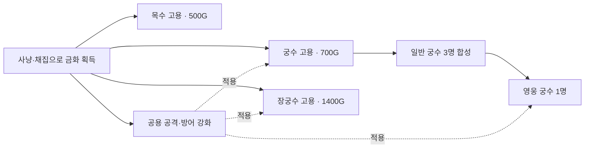

# 궁수 키우기 — 고용·성장·영웅 스킬 미리보기

2026-10-03. 현재 구현은 games `907b0b7e` 기준 확인했다. **1~3절은 현재 동작, 4절은 미구현 제안**이다. 이번 전투 AI 수정에 새 유닛·스킬을 포함하지 않는다.

## 1. 지금 고용할 수 있는 유닛

| 유닛 | 획득 비용 | 역할 | HP | 기본 공격 | 공격 간격 | 사거리 | 이동 속도 | 방어 |
|---|---:|---|---:|---:|---:|---:|---:|---:|
| 궁수 | 700G | 기본 전투병, 지상·공중 사격 | 100 | 12 | 0.55초 | 190 | 110 | 0 |
| 장궁수 | 1,400G | 장거리·장갑 적 대응, 방어 관통 4 | 150 | 34 | 0.95초 | 560 | 95 | 1 |
| 목수 | 500G | 벌목·채광·방어탑 건설·수리 | 70 | 없음 | — | — | 80 | 0 |
| 영웅 궁수 | 일반 궁수 3명 합성, 추가금 0 | 높은 화력의 정예 전투병 | 300 | 40 | 0.45초 | 220 | 110 | 2 |

거리·속도는 게임 world 단위이며 화면 픽셀과 항상 같지 않다. 영웅은 직접 구매할 수 없다. 시작 병력은 궁수 1명, 목수 0명이다. 본진 옆 치료사는 고용 유닛이 아닌 무적 중립 NPC다.

## 2. 현재 승급 단계와 강화



장궁수는 궁수의 다음 등급이 아니라 별도로 고용하는 전문 병종이다. 현재는 **궁수 → 영웅 궁수의 2단계**이며, 장궁수·목수의 승급이나 전설/신화 등급, 개별 경험치 레벨은 없다.

| 강화 | 현재 레벨 L에서 다음 단계 비용 | 효과 | 최대 단계 |
|---|---|---|---:|
| 공격 | 30 + 20×L G | 기본 피해 +2/단계, 기본 사격 간격 0.6%/단계 단축(최대 20%) | 50 |
| 방어 | 25 + 25×L G | 방어 +1/단계 | 30 |

소유자별 공용 강화이므로 이후 고용·합성한 해당 소유자의 전투 병력에도 적용된다. 예: 공격 5단계 궁수는 피해 22, 사격 간격 약 0.534초. 공격 5단계 영웅은 피해 50, 약 0.437초다. 실제 적에게 주는 피해는 적 방어와 장궁수 관통을 반영한다.

합성 조건: 같은 소유자의 살아 있는 일반 궁수 3명, 같은 지역·명령 그룹·배치 역할, 주둔 중인 유닛 제외. 재료 3명은 소비된다. 결과 체력은 재료의 평균 체력 비율을 계승하므로 합성으로 무료 완전 회복되지 않는다. 명령·가장 긴 남은 공격 대기·최근 전투 상태도 승계한다. 장궁수 3명 합성이나 영웅 재합성은 현재 불가능하다.

## 3. 현재 실제 전투 기능과 디자인

- 궁수·영웅 궁수: 자동 사격. 영웅 전용 액티브·패시브 스킬은 아직 없다.
- 장궁수: 상시 방어 관통 4. 별도 스킬 버튼은 없다.
- 목수: 자원 채집·건설·수리 명령. 전투 스킬은 없다.
- 전투 병력: 이동·공격·거점 주둔 명령, 공용 공격·방어 강화.

[기존 아군 디자인 시안](../design/images/02-allies-and-tower.png): 궁수 / 영웅 궁수 / 장궁수 / 목수와 방어탑 외형. **원화 시안이며 실제 플레이 캡처나 스킬 구현 화면은 아니다.**

기존 전체 밸런스 문서: [gameplay.md](gameplay.md). 이 문서에는 누적 변경 이전의 웨이브·적 수치가 함께 남아 있으므로 현재 전체 밸런스의 단일 기준으로 읽지 않는다. 최신 전투 수정 결과는 [status.md](../status.md)를 따른다.

## 4. 제안: 영웅 합성 시 사용할 수 있는 스킬

**사용자 확인 전 미구현. 아래 숫자는 검토용 초안이며 밸런스 검증 전이다.** 현재 2단계 성장 구조는 유지하고 영웅 합성 시 아래 두 스킬을 즉시 해금하는 작은 확장을 먼저 제안한다. 별도 마나·스킬 재료·새 등급은 추가하지 않는다.

| 스킬 | 사용 방식 | 초안 효과 | 재사용 | 목적 |
|---|---|---|---|---|
| Q · 다중 사격 | 방향 지정 | 영웅의 현재 사거리 안 70° 부채꼴에 최대 6개 적을 각각 한 번 공격. 대상당 강화 반영 공격력의 150%, 적 방어 정상 적용 | 14초 | 밀려드는 무리 정리. 단일 적에게 화살 6발이 중복 적중하지 않음 |
| E · 회피 구르기 | 지점 지정 | 최대 120 거리, 0.3초 동안 연결된 보행 경로로 이동. 공격은 이동 중 중지, 무적 효과 없음 | 10초 | 빠른 근접 몬스터와 거리를 벌리기. 절벽·벽 통과 불가 |

다중 사격은 보이는 지상·공중 적에게 사용할 수 있고, 시야·고도·사선 제한을 준수한다. 건물에는 최대 한 번 피해를 줄 수 있으며 방어를 무시하지 않는다. 같은 거리의 후보는 고정 ID 순서로 결정한다. 적이 없으면 발동하지 않고 대기시간도 소비하지 않는다.

구르기는 유효 경로에서 최대 거리까지만 이동한다. 길이 막혀 최소 24 거리도 이동할 수 없으면 발동하지 않는다. 이동 거리·경로를 먼저 검증하고 발동을 확정한다. 시전 중 사망하면 즉시 중단한다. 단순 지점 순간이동은 사용하지 않는다.

주둔 중 두 스킬은 사용하지 못하고 이유를 표시한다. 일반 사격은 그대로 유지한다. 여러 영웅을 선택했을 때는 선택 목록의 사용 가능한 영웅 1명을 고정 순서로 사용하고, 해당 영웅을 화면에서 강조한다. 한 번 눌러 모든 영웅의 스킬이 동시에 소비되지 않는다. 재사용 대기는 영웅별로 저장하고 이어하기/온라인 협동에서도 동일하게 복원한다. 협동에서는 내 영웅만 조작한다.

### UI 문구 샘플 — 구현 화면 아님

```text
[고용소]
궁수          700G   기본 전투병 · 공중 공격 가능
장궁수      1,400G   긴 사거리 · 방어 관통 4
목수          500G   채집 · 건설 · 수리

[합성]
궁수 3명 → 영웅 궁수 1명       추가 비용 없음
선택: 2 / 3명                 [합성: 조건 미충족]
※ 재료 병력은 소비되며 체력 비율을 계승합니다.

[영웅 궁수 선택 — 스킬 확장안]
Q 다중 사격       준비됨      최대 6명 · 공격력 150%
E 회피 구르기     6.2초       최대 120 이동 · 무적 없음
```

이후 새 고용 병종·영웅 전문화·추가 승급 단계를 원하면 별도 설계로 확장한다. 위 스킬 초안 승인만으로 새 등급이나 다른 병종을 자동 추가하지 않는다.

## 확인 근거

구현 담당이 현재 코드의 `UNITS`, `price`, `combine`, 사격 피해·간격 계산과 액티브 스킬 명령 부재를 확인했다. 소스: `portal-fe/public/games/marine-command/js/origin/sim.js`, 기존 명세 `spec.md` 및 `planning/gameplay.md`. 부모는 동일 구현 코드를 중복 탐색하지 않고 해당 확인 결과를 이 문서에 정리했다.
