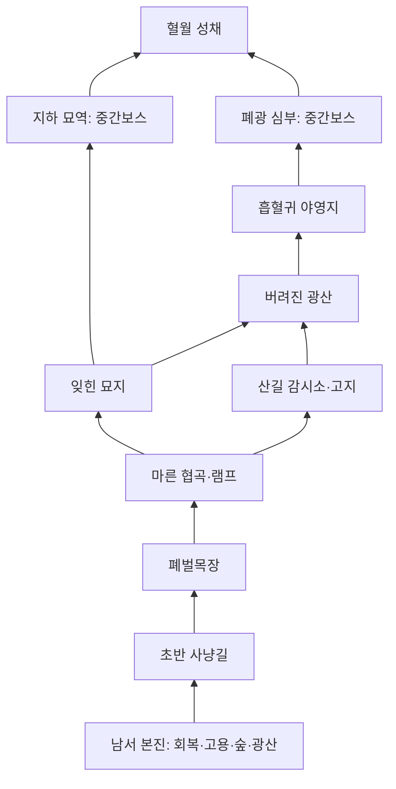

# World, elevation, fog
**참조와 유사한 구조를 위한 고정 맵 초안. 원본 전체 지형의 실측 복제라고 표기하지 않는다.**

## 규모와 동선
세계12,288×8,192, tile32, grid384×256. 좌표 원점 좌상단, +x동/+y남.
초기 카메라는 남서 본진. 한 화면에서 캠프6개가 모두 보이는 축소 지도형 전장 금지.
기본 desktop1920×1080은 세계 면적 약2.06%만 표시. 미니맵은 전체 영역, 메인 뷰는 지역.

| 노드 | 중심(x,y) | 고도 | 지형·역할 | 해금 |
|---|---|---|---|---|
| B 본진 | 1100,7100 | 0 | 샘, 고용소, 숲2·광산1, 수비 입구 | 시작 |
| F 초반 사냥길 | 1600,6500 | 0 | 약한 시체만, 회복샘 왕복 가능 | 시작 |
| C1 폐벌목장 | 2400,6200 | 0 | 넓은 앞마당·첫 분기 | 시작 |
| C2 마른 협곡 | 4200,6300 | 1 | 남쪽 램프·양옆 절벽 | C1 통로 |
| C3 잊힌 묘지 | 5700,4700 | 1 | 적 건물·묘비 엄폐·중앙 교차 | C2 또는 우회로 |
| D1 지하 묘역 | 6200,4100 | 독립 | 3방·묘지 집행자 | C1~C3 파괴 |
| C4 산길 감시소 | 3100,3400 | 2 | 북서 고지, 우회 램프 | C2 우회 |
| C5 버려진 광산 | 7800,4200 | 1 | 장갑·원거리 혼합 | C3 |
| D2 폐광 심부 | 8500,3500 | 독립 | 3방·광산 군주 | C4~C6 파괴 |
| C6 흡혈귀 야영지 | 9700,2500 | 2 | 이중 경사로·전진 거점 | C5 |
| Z 혈월 성채 | 10300,1100 | 2 | 최종 성문·백작 | D1,D2 보스 처치 |

지형 자체는 처음부터 존재한다. 해금 전진은 문/위협/이벤트로 표현하며 새로운 땅이 갑자기 생성되지 않는다.
던전 개방 조건은 양쪽 진행을 요구하되 필드 C4~C6는 D1 클리어 없이 탐험 가능.
초반 C1 주변을 반복 사냥할 수 있으며 캠프를 파괴하면 해당 리젠만 중단된다.
주둔지는 파괴 전 리젠 유지 vs 진행 해금이라는 선택을 만든다.

## 시야/고도/이동 명세
- 모든 지형 셀은 walkable, elevation(0/1/2), visionBlock, rampId, buildProtected를 가진다.
- 절벽은 두 고도간 ramp 연결 없이는 통과불가. 일반 타일간 상하차 이동은 금지, 램프만 한 단계 전환.
- sight 기본 archer260/hero280/longbow320/carpenter180/base360/tower300.
- supercover 격자 raycast로 시야: solid rock/짙은 숲 셀에서 정지, 낮은 시야원에서 높은 plateau 내부 차단.
  고지→저지 관측은 허용하지만 중간 더 높은 절벽/숲은 계속 차단. 시야와 사격 LOS는 같은 차단 정보 사용.
- 고지 보너스는 기본판에서 시야·지형 이점만. 숨은 명중률 페널티 없음.
- 저지→고지 사격은 목표가 아군 고지 시야로 보이고, 발사체 LOS가 램프/열린 가장자리를 통과할 때만.
- 탐색 bitset, 현재 시야 bitset을 분리. 현재 시야는10Hz 갱신, 기억은한번1→계속1.
- 기억에는 지형/마지막 관측 정적 시설만 남음. 적·적 그림자·현재 건물HP·효과·원거리 소리는 가림.
- 아군은 개인 UI에 위치를 알 수 있으나 아군 카메라 밖 적은 자동 화면 표시하지 않음. coop은 팀 시야 공유.
- 이동 목적지 최대 탐색예산 초과 시 분할 재탐색, 경로없음 피드백. 한 프레임에 전군 A* 무제한 호출 금지.
- 이동/충돌은 지면 좌표. 렌더 sprite foot pivot에 고도 offset을 적용하고 y+고도 층으로 겹침 정렬.

## 던전
각 별도 영역1536×1536. 문턱, 방1 잡몹6, 방2 혼합8, 방3 보스1+호위4.
던전 방 진입이 필수 스폰 예약을 만든다. queued/pending/alive 모두0일 때만 클리어.
동료는 필드/다른 던전에 있을 수 있고 본진 웨이브는 계속 시뮬레이션.
입구 근처 선택 원정대만 진입. 주둔 병력/목수는 현장 잔류. 퇴각은 진입구로 되돌아감.
클리어 보상 재수령 금지. 진행중 이탈/저장으로 이미 얻은 보상과 리젠 보상을 무한 복제하지 않음.

<!-- source: portal-fe/public/games/marine-command/js/sim.js -->

## 地域별 초기 배치 (재구성 수치 제안)
약어 Z=zombie/G=ghoul/P=plague/B=bat/A=armored/V=vampire. 중심은 위 노드좌표.
| 지역 | 초기 병종/수 | 리젠 | 스폰 영역·클리어 |
|---|---|---|---|
| F | Z2 | 12초마다Z2,생존최대4 | (1600,6500) 반경120, C1과 독립·영구사냥가능 |
| C1 | Z2 | 20초마다Z2,최대8 | 중심반경160,캠프본체HP0클리어 |
| C2 | Z6 G2 | 20초마다Z2 G1,최대16 | 중심반경180,본체HP0 |
| C3 | Z5 G3 P2 | 20초마다Z1 G1 P1,최대16 | 중심반경200,본체HP0 |
| C4 | G4 P2 B4 | 20초마다G1 P1 B1,최대16 | 중심반경200,본체HP0 |
| C5 | Z4 P4 A4 | 20초마다Z1 P1 A1,최대16 | 중심반경220,본체HP0 |
| C6 | G4 B4 A4 V2 | 20초마다B1 A1 V1,최대16 | 중심반경240,본체HP0 |
| D1방1/2/3 | Z4 G2 / G4 P4 / executioner1 Z4 | 재생성없음 | 아래공유인스턴스기준 |
| D2방1/2/3 | A2 G4 / A4 P4 / mine_lord1 A2 V2 | 재생성없음 | 아래공유인스턴스기준 |
| Z성채 | count1 V4 A4 | 소환패턴만 | finalHP0시캠페인승리 |

기본 aggro240/leash360, C4~C6 aggro300/leash500. F leash300.
범위 이탈 시 원위치로 돌아가되 HP무료회복 없음. 공중도 캠프 leash 준수.
캠프 본체파괴 후 남은적은 유지하되 리젠만 멈춘다. 필수 처치방은 alive+pending+queued0이어야완료.
보스는 방/성채의 지정 전투영역 밖으로 추격하지 않는다. 범위를 나가도 HP/보상상태는 리셋하지 않음.
스폰 점은 영역 내 고정 후보셀(맵데이터) 순회, walkable/같은고도/출구겹침 검사. 후보가 없으면 스폰예약 유지.
본진웨이브는 고정 노드 W=(2600,6800)에서 남서 본진으로 공격이동. F쪽초기사냥영역과 동선을 분리.
역습은 파괴된캠프 북측/동측 두점(중심±120),장애면 유효후보셀로 대체.

## 필수 램프/문 저작 계약
| 연결 | 중심/폭/길이(world) | 고도 | 이동 조건 |
|---|---|---|---|
| B–F–C1 | (1750,6500),폭320연속길 | 0 | 처음부터열림 |
| C1→C2 남쪽램프 | (3500,6400),128×256 | 0→1 | C1파괴후 문열림 |
| C2→C3 협곡길 | (4900,5500),폭192 | 1 | 항상열림 |
| C2→C4 우회램프 | (3500,4700),128×256 | 1→2 | 항상열림 |
| C4→C5 동쪽하행램프 | (5400,3500),128×256 | 2→1 | 항상열림 |
| C3→D1 | (6100,4200),폭128문 | 1 | C1~C3파괴 |
| C5→C6 램프 | (8800,3200),128×256 | 1→2 | C5파괴 |
| C6→D2 서쪽하행입구 | (8700,3400),128×256 | 2→1 | C4~C6파괴 |
| C6→Z 성채문 | (10100,1700),폭192문 | 2 | D1,D2완료 |

이 중심/연결은 지도재구성초안이며 경로세부polyline·cliff polygon은 T0 근사범위확인후 T2저작데이터에서 고정한다.
문닫힘에 따른 반대편 시야는 문재질이차단. 램프와문 양옆2셀은 건설보호.
T0기준확인전 전체지형을 원본과 동일하다고 확정하거나 이미지에서 임의 맵을자동생성하지않는다.

## 공유 던전 상태표
캠페인당 dungeonId별 인스턴스1개. 두 소유자가 공유하고 상대진입이 복제방을 만들지 않는다.
| 사건 | 상태 처리 |
|---|---|
| 첫입장 | room1 encounterId생성, 정해진 스폰1회예약 |
| 동료후입장 | 현재진행방의 안전문턱에배치, 기존적·보스HP/스폰/보상원장유지 |
| 한소유자퇴각 | 해당원정대만 필드입구복귀, 나머지와적전투계속 |
| 전원퇴각/전멸 | 인스턴스그대로보존, 적AI·공격타이머·pending스폰진행은 휴면, 필드웨이브는계속 |
| 재입장 | 직전완료방의문턱 또는 현재방입구, 휴면해제. 살아남은적HP·죽은적·스폰예약모두보존 |
| 동료만보스처치 | 캠페인공유완료, 보상은해당처치기여자, 퇴각자재입장으로추가보상없음 |
| 저장/복구 | 위상태·휴면·encounterId·보상원장·room gates그대로복원 |

방중심 y350/800/1250,문 y575/1025, x768을통과하는폭192통로,입장문턱(768,145).
방클리어가다음문을열며 다음방문턱통과때 다음encounter가한번시작한다.
