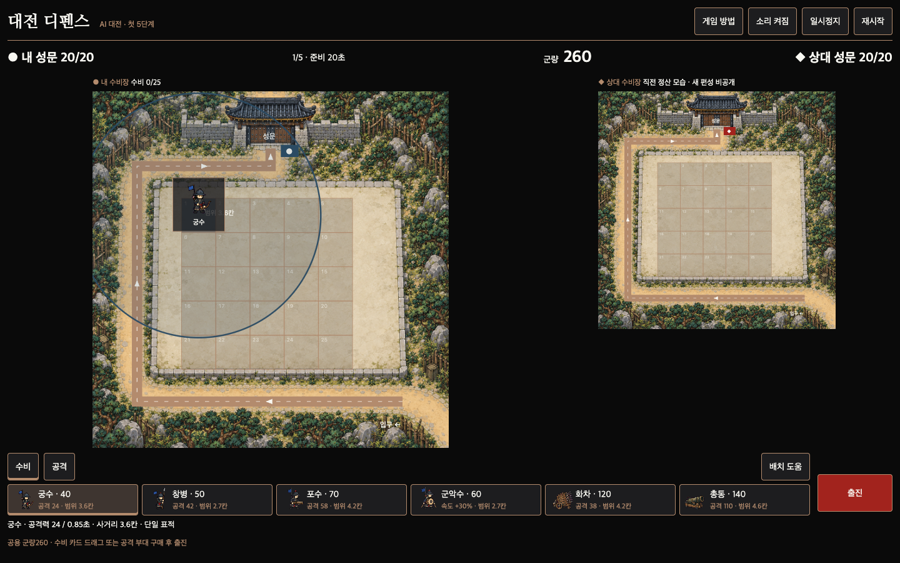
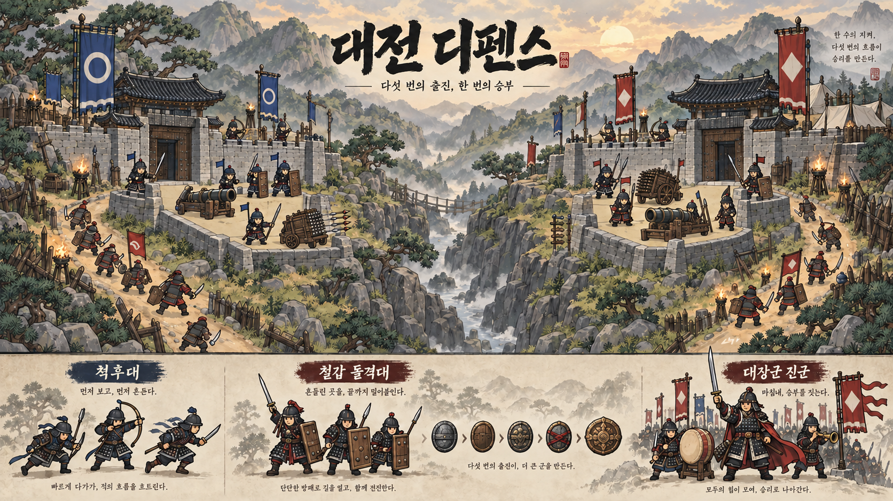
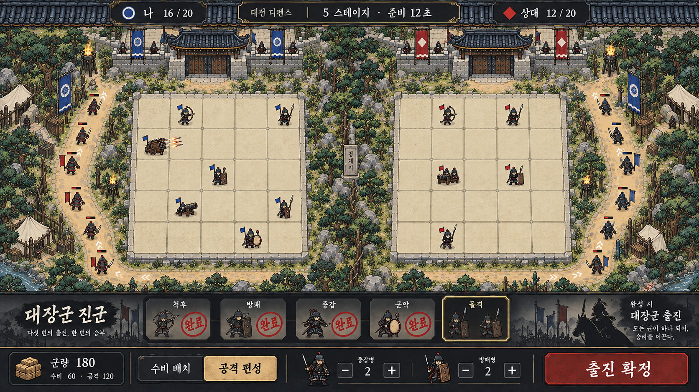

# 대전 디펜스 — 1:1 대전 타워디펜스 기획·시안

상태: **R6 구현·검증 완료 — 15웨이브·공격 연구비10% 인하, BETA 배포·공개 검증 완료**. 사용자 요청: 2026-10-06. 현행 변경은 [R6 명세](iterations/06-fifteen-waves-beta.md), 병과 성장·걷기는 [R4 확장](iterations/04-twenty-stage-balance.md)을 따른다. 기존 클릭/드래그 입력과 공용군량을 유지한다. 진행 항목은 [tasks.md](tasks.md). 수치는 플레이 가능한 첫 밸런스이며 최종 난이도 확정은 아니다.

2026-10-06 [R5 관통 순서](iterations/05-pierce-order.md)가 해당 수치를 갱신한다: 창병22 > 화차18 > 총통12 > 포수10 > 궁수0. 강화 추가+4/+8은 유지하며 같은 레벨의 순서도 유지한다.

R6 [통합 검증](verifications/r6-final-verification.md), [벤치마크 비교](verifications/r6-benchmark-review.md). 단위21개·실제 연구비 차감·15단계 종료 확인. 현재 AI 대전이며 온라인 사람 대전은 미구현, 히든 조합은 사용자 요청대로 보류했다.

## 플레이

공개 베타: https://game.1989v.com/games/duel-defense/index.html — AI 상대. [배포 증거](verifications/r6-beta-deployment.md).

로컬 서버: `node portal-fe/public/games/duel-defense/tools/serve.mjs`, 주소 `http://127.0.0.1:4179`.
첫 준비 군량280 → 수비 카드를 클릭해 커서 배치 또는 드래그 → 남은 군량으로 공격 부대 구매 → 우측 상단 바로 시작. 15단계에서 경장/빠른 적/방패/중갑/공성 혼합과I~III 등급에 대응한다. 준비는 첫45/2~5단계30/6~10단계20/11~15단계15초. 수비Lv2는4단계/Lv3는9단계, 병종 연구Lv2는6단계/Lv3는11단계부터 같은 군량으로 구매한다. 병과 상세에 기본 연사·관통·방어력·강화 후 변화를 표시한다. 유료 공격7종과 대장군180을 직접 구매한다. 상대는 AI이며 히든 조합·온라인은 후속이다.

[게임 실행 안내](../../../portal-fe/public/games/duel-defense/README.md). 이전 [P1 통합 검증](verifications/final-verification.md)과 [P1 리뷰](verifications/fresh-review.md)는 이전 구현 이력이다.

R2 [통합 검증 보고서](verifications/r2-final-verification.md), [규칙12개 통과](verifications/r2-unit-output.txt), [실제 드래그·유료 부대·5단계 Chrome 검증](verifications/r2-e2e-output.txt), [독립 리뷰 SHIP](verifications/r2-review.md).

R3 [통합 검증 보고서](verifications/r3-final-verification.md), [규칙13개 통과](verifications/r3-unit-output.txt), [실제 입력·준비 시간](verifications/r3-e2e-output.txt), [독립 리뷰 SHIP](verifications/r3-review.md). [최종 데스크톱](verifications/shots/r3-final-timer-1440.png), [최종 모바일](verifications/shots/r3-final-timer-390.png).

R4 [통합 검증](verifications/r4-final-verification.md), [독립 리뷰](verifications/r4-review.md), [새 분리 파츠 원화/프롬프트](planning/visuals/03-rig-parts-r4.md), [실제 걷기 필름스트립](verifications/r4-actual-footplant-filmstrip.png). Core19개 통과, 전체20 domain simulation 완료13.17분, 실제 입력·성장 UI·6병과 이펙트·6화면 확인. 성장 UI 일부는 테스트 clock을 가속했고 걷기 녹화는 실제15초이며, 전체20을 실제 wall-clock으로 반복 플레이했다고 주장하지 않는다.

[공격 부대 가격·체력·속도 화면](verifications/shots/r2-attack-stats-desktop.png), [최종 데스크탑 배치](verifications/shots/r2-layout-1440x900.png).

한 줄: **수비를 버틸 만큼만 쓰고, 아낀 군량으로 강한 부대를 보내 상대 성문을 무너뜨린다.**

각자 수비장과 공용 군량의 수비·공격 배분으로 승부한다. 히든 공격 조합은 후속 아이디어로 보류한다. 기존 쌍성 수비대의 한국 무장·병기 원화를 계승한다. **사용자 확정 이름은 대전 디펜스(2026-10-04)**다.

사용자 네이밍 기준: 낯선 한자 조합을 만들지 않는다. 익숙한 영어를 한글 발음으로 쓰거나 뜻이 바로 읽히는 쉬운 한국어를 쓴다. 조선시대 분위기는 제목을 한자화하기보다 캐릭터·배경·병기로 표현한다.

## 컨셉아트

컨셉아트의 제목은 사용자 확정 이름으로 수정했다. 최초 이미지와 생성 프롬프트는 이력으로 보존한다.

두 성문은 독립된 승패 목표다. 아래 병종 시트는 아트 검토용이며 실게임 HUD에 들어가지 않는다. 그림 속 다리와 진법 인장은 장식이며 실제 이동 경로·조합 규칙을 정의하지 않는다.

## P1 전투 화면 시안 — 이전 조합 방식의 이력

이전 시안의 장부는 R2에서 제거했다. 생성 이미지의 격자·글자·경로·수치는 구현 계약이 아니다. 현행 화면·규칙은 [R2 명세](iterations/02-direct-purchase.md)를 따른다.

사용자 요청으로 양측을 5×5(25칸)로 수정하고 캐릭터 크기를 줄였다. 수정 이미지에서 5열·5행을 눈으로 확인했다. 출력 파일은 **1672×940**이며 고해상도 요청에도 픽셀 해상도는 기존보다 높아지지 않았다. [수정 프롬프트와 검토](planning/visuals/grid-revision-prompt.md)에 결과와 한계를 기록했다.

## 검토할 핵심

- **사용자 확정(2026-10-04): 스테이지 지급 공용 군량을 수비와 공격에 분배한다.** 지급량·비용·이월 수치는 아직 제안이다.
- 수비를 적게 투자하면 비싼 공격 부대를 보낼 수 있지만 내 성문이 먼저 무너질 위험이 있다.
- 공격 부대는 가격·체력·이동속도·성문 피해를 보고 직접 구매한다. 이번 준비 편성은 출진 전에 숨긴다.
- 히든 조합은 후속 아이디어로 보류하며 현재 게임에는 적립/완성 보상이 없다.

## 문서

- [현행 R2 수정 명세](iterations/02-direct-purchase.md)
- [P1 기획 이력](planning/game-plan.md), [명세·현행 우선순위](spec.md), [구현 태스크](tasks.md)
- [사용자 요구사항과 제안 구분](planning/requirements.md)
- [아트·화면 기준](DESIGN.md)
- [플레이 검증 계획](planning/test-quality.md)
- [결정할 항목](context/open-questions.yml)
- [원문](planning/initialization.md), [생성 프롬프트](planning/visuals/prompts.md)

신규 `portal-fe/public/games/duel-defense/`에 로컬 AI 상대와 첫 5단계를 구현했다. 기존 협동 게임은 보존했다. 온라인 구조는 기존 협동 게임을 그대로 사용한다고 가정하지 않으며, 후속 단계에서 별도 검토한다. 운영 배포·카탈로그 등록은 이번 범위 밖이다. 원화는 실제 sprite로 추출해 고정 스텝 전투에 연결하며 시안 통이미지가 게임을 대체하지 않는다.
