# 배포 후 운영 측정 (TG6 6.4·6.5) — 2026-10-11 15:20~15:55 KST

운영 `https://place.1989v.com`. 기준선은 `pre-measure.md`(번들 `index-BMyWfW_2.js`)이고, 같은 고정 질의·같은 관광지 id 로 다시 쟀다.
크롬은 독립 프로필 헤드리스를 `scripts/cdp-chrome.sh` 로 띄우고 start·측정·stop 을 한 명령으로 묶었다(`2026-10-10-place-screen-polish/verifications/scripts/run.sh`). 실행마다 「이 세션」 크롬 `(없음)`.
드라이버(판정 근거 = 대상 페이지의 DOM 사각형·계산 스타일·`layout-shift` 항목·`document.activeElement`·화면이 받은 검색 응답 본문):
`scripts/hub-after.mjs` · `scripts/detail-after.mjs` · `scripts/contrast-after.mjs` · `scripts/ledger.mjs` · 캡처 `scripts/shots-detail.mjs` · `scripts/shots-theme.mjs`.
UA 는 사람 브라우저(모바일 Pixel 8 · 데스크톱 Mac Chrome). 원장 확인(`ledger.mjs`) 외의 측정은 `/api/v1/events` 를 막아 측정 클릭이 운영 원장에 들어가지 않게 했다(허브 측정 `hub-after.mjs` 만 막지 않았다 — 노출 26회분이 원장에 들어갔고 클릭은 없다).

## 0. 측정 대상이 새 번들인가 (SR-8.8)

| 확인 | 결과 |
|---|---|
| 허브 HTML 이 싣는 번들 | `index-dXbP3TLy.js` (배포 전 `index-BMyWfW_2.js`) — 측정한 모든 화면의 `document.scripts` 도 이 이름 |
| `PlacePage-Bloua_6b.css` | `place-card-badges` 3 · `place-action-bar` 26 · `place-jump` 5 · `scroll-padding-bottom` 1 |
| `PlacePage-BsKt0YG_.js` | `place-card-badges` 1 |
| `AttractionPage-C6bDRu8B.js` | `place-action-bar` 8 · `place-jump` 1 · `action_bar` 1 · `SECTION_JUMP` 1 |
| 운영 파드 이미지 | portal-fe · search · search-consumer · analytics 모두 `0a8afc3`(analytics 기동 06:19 UTC = 15:19 KST) |

## 1. 허브 카드 — 전·후 (SR-8.2 · 8.5)

같은 질의의 첫 10장 id 는 전·후가 같다(순서까지). 높이·첫 카드 y·CLS 는 3회 값이다(높이·y 는 3회 모두 같았다).

| 뷰포트 | 언어 | 질의 | 높이 중앙값 전 → 후 | 최댓값 전 → 후 | 첫 카드 y 전 → 후 | scrollWidth/clientWidth | 로드 CLS 중앙값 전 → 후 (후 3회) |
|---|---|---|---|---|---|---|---|
| 390×844 | 국 | none | 131.4 → **116.5** | 152.5 → 137.6 | 178 → 178 | 390/390 | 0.0253 → 0.0253 (0.0253 ×3) |
| 390×844 | 국 | sido51 | 131.4 → **116.5** | 152.5 → 137.6 | 178 → 178 | 390/390 | 0.0218 → 0.0253 (0.0253 ×3) |
| 390×844 | 영 | none | 152.5 → 137.6 | 179.4 → 164.5 | 178 → 178 | 390/390 | 0.0424 → 0.0442 (0.0442 · 0.1429 · 0.0442) |
| 390×844 | 영 | sido51 | 152.5 → 137.6 | 176.5 → 161.6 | 178 → 178 | 390/390 | 0.0424 → 0.0442 (0.0442 ×3) |
| 1440×900 | 국 | none | 131.4 → 116.5 | 152.5 → 137.6 | 256 → 256 | 1440/1440 | 0.0011 → 0.0011 |
| 1440×900 | 국 | sido51 | 131.4 → 116.5 | 152.5 → 137.6 | 256 → 256 | 1440/1440 | 0.0011 → 0.0043 |
| 1440×900 | 영 | none | 152.5 → 137.6 | 179.4 → 164.5 | 256 → 256 | 1440/1440 | 0.0016 → 0.0016 |
| 1440×900 | 영 | sido51 | 152.5 → 137.6 | 176.5 → 161.6 | 256 → 256 | 1440/1440 | 0.0016 → 0.0027 |

- 카드 높이는 모든 조합에서 한 줄(약 15px) 줄었다. 390 국 중앙값 116.5 ≤ 120.
- CLS 증가 최대 +0.0035(390 국 sido51) — 기준선 + 0.01 안, 모두 ≤ 0.1. 영 none 의 0.1429 는 3회 중 1회다(중앙값 판정).
- 카드 `scrollWidth > clientWidth` 0/260(26회 × 10장), 카드 주소 줄(`.place-card-addr`) 0/260.
- 허브 `html` `scroll-padding-bottom` = `auto`, `.place-action-bar` 없음 — 26/26 화면(상세 전용 범위).

### 변화량 (390, 첫 10장)

| 언어 | 질의 | 카드 상태 배지 전 → 후 | 지역 라벨 전 → 후 | 찜 전 → 후 | 배지 줄 높이 최대 | 지역 라벨 `clientWidth` 최소 |
|---|---|---|---|---|---|---|
| 국 | none | 0/10 → **10/10** | 0/10 → **10/10** | 0/10 → 0/10 | 24px (한 줄) | 95px |
| 국 | sido51 | 0/10 → **10/10** | 0/10 → **10/10** | 0/10 → 0/10 | 24px | 127px |
| 국 | sido26 (채움률용 셋째) | — → 10/10 | — → 10/10 | — → 0/10 | 24px (넘친 배지 2개는 줄 밖에서 숨음) | 95px |
| 영 | none | 0/10 → **8/10** | 0/10 → **10/10** | 0/10 → 0/10 | 24px | 119px |
| 영 | sido51 | 0/10 → **9/10** | 0/10 → **10/10** | 0/10 → 0/10 | 24px | 164px |
| 영 | sido26 | — → 9/10 | — → 10/10 | — → 0/10 | 24px | 141px |

- 영문 배지 카드는 8/10·9/10 이다 — Q13 의 「3/10 미만이면 다시 묻는다」에 해당하지 않는다. 영문 배지는 휴무·무료·주차뿐이다(반려·무장애 원천 0).
- 찜 0/10 은 결함이 아니다 — 운영 색인에 `savedCount` 있는 문서가 0건이다(`pre-measure.md` §4).
- 오늘(일요일)이 휴무 요일인 카드는 표본에 없어 `closedToday` 배지는 0장이다. 색은 §3 에서 같은 클래스를 붙여 쟀다.
- 지역 라벨 최소 폭 95px ≥ 48px. 영 sido51 은 10장 중 8장이 말줄임(「…-gun, Gangwon-do」가 길다)이지만 폭은 164px 이다.
- 배지 줄은 li 의 top 이 모두 한 줄이었고(국 sido26 의 한 장만 넘친 배지 2개가 둘째 줄로 내려가 `max-height` 밖에서 숨었다), 줄 높이는 260장(26회) 모두 24px 이하.

### 같은 id 8장 — 배포 전·후 캡처 (390)

| # | id | 전 | 후 | 높이 전 → 후 | 후 meta 줄 · 카드 상태 배지 |
|---|---|---|---|---|---|
| 국 1 | 1 경복궁 | 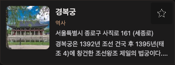 | 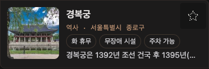 | 132 → 117 | 역사 · 서울특별시 종로구 · 화 휴무 / 무장애 시설 / 주차 가능 |
| 국 2 | 9 남산공원 | 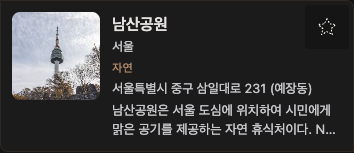 | 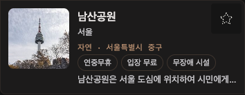 | 153 → 138 | 자연 · 서울특별시 중구 · 연중무휴 / 입장 무료 / 무장애 시설 |
| 국 3 | 12 사육신공원 | 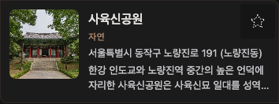 | 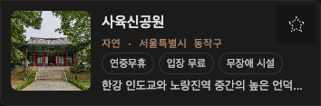 | 132 → 117 | 자연 · 서울특별시 동작구 · 연중무휴 / 입장 무료 / 무장애 시설 |
| 국 4 | 17 청계산 | 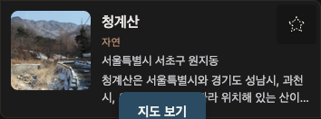 | 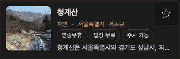 | 132 → 117 | 자연 · 서울특별시 서초구 · 연중무휴 / 입장 무료 / 주차 가능 |
| 국 5 | 32 관악산 | 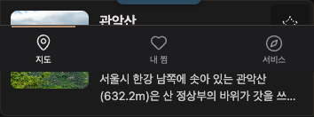 | 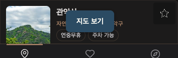 | 132 → 117 | 자연 · 서울특별시 관악구 · 연중무휴 / 주차 가능 |
| 국 6 | 37 서대문독립공원 | 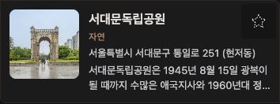 | 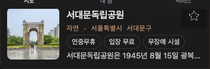 | 132 → 117 | 자연 · 서울특별시 서대문구 · 연중무휴 / 입장 무료 / 무장애 시설 |
| 국 7 | 39 충무공 이순신 동상 | 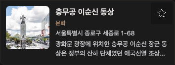 | 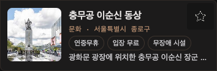 | 132 → 117 | 문화 · 서울특별시 종로구 · 연중무휴 / 입장 무료 / 무장애 시설 |
| 국 8 | 40 세종대왕 동상 | 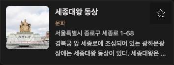 | 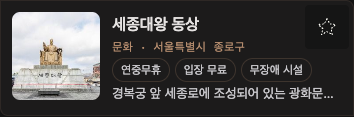 | 132 → 117 | 문화 · 서울특별시 종로구 · 연중무휴 / 입장 무료 / 무장애 시설 |
| 영 1 | 21 Gyeongbokgung Palace | 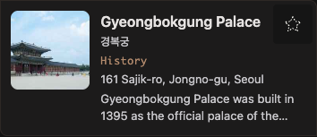 | 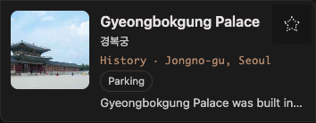 | 153 → 138 | History · Jongno-gu, Seoul · Parking |
| 영 2 | 24 Insa-dong | 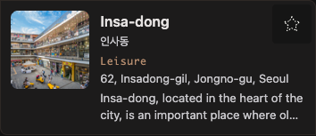 | 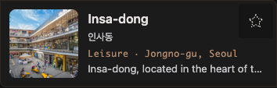 | 153 → 113 | Leisure · Jongno-gu, Seoul · (배지 없음) |
| 영 3 | 1625 Seoul Cruise | 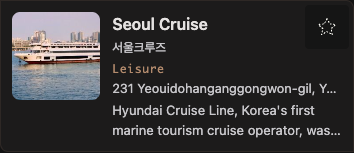 | 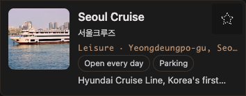 | 153 → 138 | Leisure · Yeongdeungpo-gu, Seoul · Open every day / Parking |
| 영 4 | 1651 Songhyeon Green Plaza | 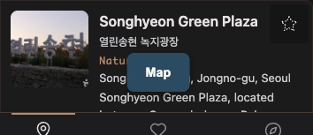 | 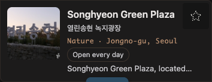 | 153 → 138 | Nature · Jongno-gu, Seoul · Open every day |
| 영 5 | 1652 Youngchive Seongsu | 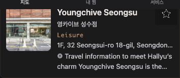 | 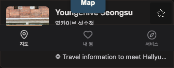 | 153 → 138 | Leisure · Seongdong-gu, Seoul · Open every day |
| 영 6 | 1656 Seongbuk-dong–Bukchon | 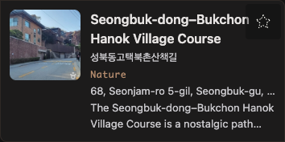 | 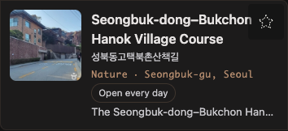 | 177 → 162 | Nature · Seongbuk-gu, Seoul · Open every day |
| 영 7 | 1658 Euljiro Nogari Alley | 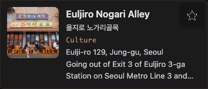 | 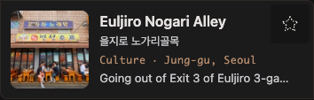 | 153 → 113 | Culture · Jung-gu, Seoul · (배지 없음) |
| 영 8 | 1662 Alleys of Changsin-dong | 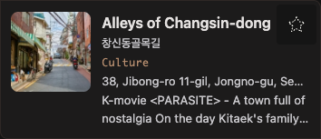 | 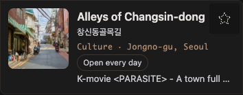 | 153 → 138 | Culture · Jongno-gu, Seoul · Open every day |

높이는 캡처 PNG 의 세로 픽셀(카드 사각형 높이 올림)이다. 화면 전체: `screens/{before,after}/hub-{390,1440}-{ko,en}-{none,sido51}.png`, 사이트 정경별 후 캡처 `screens/after/hub-{390,1440}-{ko,en}-{light,dark}.png`.

## 2. 응답 `sigunguName` 채움률 (SR-8.7)

허브 390 첫 페이지(크기 30)에서 화면이 실제로 받은 검색 응답 본문을 셌다.

| 언어 | 질의 | 응답 | `sigunguName` 있음 | `region`(목록은 null 이 정상) |
|---|---|---|---|---|
| 국 | none (`sidoCode` 없음 → 자동 선택 `11`, 응답 둘) | 30 · 30 | 30 · 30 | 0 · 0 |
| 국 | sido51 | 30 | 30 | 0 |
| 국 | sido26 | 30 | 30 | 0 |
| 영 | none (응답 둘) | 30 · 30 | 30 · 30 | 0 · 0 |
| 영 | sido51 | 30 | 30 | 0 |
| 영 | sido26 | 30 | 30 | 0 |

240/240 = 100%. 색인 기대치(허브 범위 국 100% · 영 99.9%)와 같다.

## 3. 대비 4조합 (SR-8.3)

기기 정경은 값에 영향이 없었다(같은 사이트 정경끼리 전 항목 같음). `*` 는 없는 상태를 같은 클래스로 붙여 잰 값(오늘 휴무 배지 · 찜 켜짐).

| 항목 | 사이트 라이트 (기기 light·dark) | 사이트 다크 (기기 light·dark) | 기준 |
|---|---|---|---|
| 카드 meta(분류) | 4.82 `#8a6346`/`#f5f4ee` | 5.59 | ≥ 4.5 |
| 카드 지역 라벨 | 4.82 | 5.59 | ≥ 4.5 |
| 카드 상태 배지(일반) | 8.53 `#46464a` | 10.11 | ≥ 4.5 |
| 카드 상태 배지 `closedToday`* (굵기 700) | 9.63 `#1a472a` | 6.08 `#6f9fc4` | ≥ 4.5 |
| 카드 찜 수 | 없음(색인 0건) | 없음 | — |
| 바 글자 — 길찾기 · 찜 · 공유 · 전화 | 15.82 · 15.82 · 15.82 · 15.82 | 15.82 · 15.82 · 13.06 · 15.82 | ≥ 4.5 |
| 바 공유 칸 글자 | 「공유」(헤드리스에 `navigator.share` 있음) | 같음 | — |
| 바 아이콘 — 길찾기 · 별 꺼짐 · 공유 · 전화 | 15.82 · 6.81 · 15.82 · 15.82 | 15.82 · 5.31 · 13.06 · 15.82 | ≥ 3 |
| 바 별 켜짐* | 15.82 | 13.06 | ≥ 3 |
| 포커스 링 — 바 길찾기 · 찜 · 공유 · 전화 | 15.82 ×4 (`solid 2px`, offset −4px) | 13.06 ×4 | ≥ 3 |
| 포커스 링 — 이동 링크 | 9.98 | 6.58 | ≥ 3 |
| 이동 줄 링크 기본 · hover · focus | 8.83 · 15.82 · 15.82 | 10.93 · 14.42 · 14.42 | ≥ 4.5 |

최솟값: 글자 4.82(라이트 카드 meta·지역 라벨), 아이콘 5.31(다크 별 꺼짐), 포커스 링 6.58(다크 이동 링크). 캡처: `screens/after/hub-390-{ko,en}-{light,dark}.png`, `screens/after/detail-390-ko-77-bar-jump-{light,dark}.png`.

## 4. 상세 390×844 — 표본 12곳 × 3회 (SR-8.4 · 8.5)

| 언어 | id | 머리띠 bottom | 길찾기 bottom (폴드 ≤ 664) | 첫 화면 바 숨김 | 스크롤 후 표시(ms, 3회 최대) | 다시 올리면 숨김 | 칸 | 이동 줄 겹침 | 문서 끝 내용 bottom / 바 top | Tab 가림 (바 보일 때 본문 포커스 수 중 가림) | CLS 중앙값 전 → 후 |
|---|---|---|---|---|---|---|---|---|---|---|---|
| 국 | 77 | 60 | 260 안 | 3/3 | 3/3 (30) | 3/3 | 4 · 98×55 | 0 | 712 / 680 **✗** | 127 중 **25** | 0 → 0 |
| 국 | 4811 | 60 | 260 안 | 3/3 | 3/3 (15) | 3/3 | 4 · 98×55 | 0 | 712 / 680 **✗** | 127 중 **22** | 0 → 0 |
| 국 | 16151 | 60 | 260 안 | 3/3 | 3/3 (19) | 3/3 | 4 · 98×55 | 0 | 712 / 680 **✗** | 130 중 **36** | 0 → 0 |
| 국 | 12933 | 60 | 260 안 | 3/3 | 3/3 (18) | 3/3 | 4 · 98×55 | 0 | 712 / 680 **✗** | 127 중 **16** | 0 → 0 |
| 국 | 2961 | 60 | 260 안 | 3/3 | 3/3 (11) | 3/3 | 4 · 98×55 | 0 | 712 / 680 **✗** | 130 중 **28** | 0 → 0 |
| 국 | 47 (전화 없음) | 60 | 260 안 | 3/3 | 3/3 (16) | 3/3 | 3 · 130×55 | 0 | 712 / 680 **✗** | 131 중 **18** | 0 → 0 |
| 영 | 13863 | 60 | 317 안 | 3/3 | 3/3 (21) | 3/3 | 4 · 98×55 | 0 | 712 / 680 **✗** | 126 중 **15** | 0 → 0 |
| 영 | 13808 (머리띠 두 줄) | 86 | 377 안 | 3/3 | 3/3 (8) | 3/3 | 4 · 98×55 | 0 (이동 줄 top 86) | 712 / 680 **✗** | 126 중 **17** | 0 → 0 (0.0259 · 0 · 0) |
| 영 | 18083 | 60 | 317 안 | 3/3 | 3/3 (14) | 3/3 | 4 · 98×55 | 0 | 712 / 680 **✗** | 126 중 **14** | 0 → 0 |
| 영 | 14580 | 60 | 351 안 | 3/3 | 3/3 (17) | 3/3 | 4 · 98×55 | 0 | 712 / 680 **✗** | 127 중 **17** | 0 → 0 |
| 영 | 14367 | 60 | 289 안 | 3/3 | 3/3 (17) | 3/3 | 4 · 98×55 | 0 | 712 / 680 **✗** | 126 중 **17** | 0.0011 → 0 |
| 영 | 1658 (전화 없음) | 60 | 288 안 | 3/3 | 3/3 (19) | 3/3 | 3 · 133×55 | 0 | 730 / 698 **✗** | 131 중 **19** | 0 → 0 |

- 첫 화면 바 숨김 12/12(`hidden` 속성 + `display: none`), 표시 12/12(최대 30ms), 길찾기 폴드 안 12/12, 바 높이 56px, 칸 최소 98×55(≥ 44×44), 이동 줄 겹침 0px 12/12(머리띠 두 줄인 13808 도 이동 줄 top = 86).
- 절 이동(링크 넷 모두, 12곳): 클릭 뒤 `document.activeElement` = 그 절 48/48, 주소 해시 없음 48/48. 「방문 정보」·「주변」은 절 top(104) ≥ 이동 줄 bottom(104). 「요약」·「가는 법」은 `.place-detail-first` 안이라 이동 줄보다 위에 있어(Q15) 이동 줄이 아직 붙지 않은 자리(제 위치, 절 아래쪽)에 있다 — 절을 가리지 않는다.
- CLS(로드 + 끝까지 스크롤 + 이동 링크 1회) 중앙값 12/12 가 0 — 기준선 + 0.01 안.
- **미달 — 문서 끝 마지막 내용이 바 밑에 깔린다(0/12, 32px)·Tab 포커스가 바에 가린다(12/12 페이지에서 14~36개).** 원인은 바의 실제 위치다: 바 `bottom` 계산값은 `60px`(탭바 높이 `--kh-shell-bottom`)인데 사각형 bottom 은 736 이다(기대 784). `components/Footer.css:17` 의 `#root :has(+ .site-footer) { margin-bottom: var(--ko-space-12) }` 가 `.site-footer` 바로 앞 형제인 `.place-action-bar` 에도 걸려 고정 배치 바에 `margin-bottom: 48px` 이 붙고, 바가 48px 위로 뜬다. 하단 여백·`scroll-padding-bottom`(116px)은 바가 탭바 바로 위(top 728)에 있다고 보고 잡혀 있어 그 48px 만큼 내용·포커스가 가린다. 같은 이유로 바와 탭바 사이 55px 띠(바 bottom 736 ~ 탭바 top 791)에 본문이 비쳐 보인다(`screens/after/detail-390-ko-77-bar-jump.png`·`-end.png`). 이 55px 중 7px 은 `--kh-shell-bottom`(60px)과 실측 탭바 높이(53px)의 차이다. 고치지 않고 보고한다.
- 캡처: `screens/after/detail-390-{ko-77,en-13808,ko-47}-{top,bar-jump,end}.png`(첫 화면 바 숨김 · 바 표시 + 이동 줄 고정 · 문서 끝).

## 5. 원장 도착 · 인기 집계 제외 (SR-8.6)

사람 UA(`Mozilla/5.0 (Linux; Android 14; Pixel 8) … Chrome/141.0.0.0 Mobile Safari/537.36`) CDP 세션, 국 77 상세, 15:39 KST. 바가 보인 상태에서 바 길찾기 → 바 공유 → 바 전화 → 이동 링크(「방문 정보」)를 한 번씩 눌렀다(새 탭·`tel:` 이동만 막고 계측은 그대로). 요청 응답은 전부 202.

`ssh msa-oci` → `clickhouse-0` `analytics.events`, `view_id = 'fd1a1024-8246-4aa4-9a9a-3e02a3c7c81b' AND action = 'CLICK'`:

| section_id | entity | screen | payload | timestamp (UTC) |
|---|---|---|---|---|
| DIRECTIONS | 77 | ATTRACTION_DETAIL | `{"kind":"google_maps_directions","source":"action_bar"}` | 06:39:55.587 |
| SHARE | 77 | ATTRACTION_DETAIL | `{"kind":"attraction","channel":"share","source":"action_bar"}` | 06:39:55.991 |
| PHONE | 77 | ATTRACTION_DETAIL | `{"source":"action_bar"}` | 06:39:56.392 |
| SECTION_JUMP | 77 | ATTRACTION_DETAIL | `{"target":"info"}` | 06:39:56.794 |

원장 행 4/4 도착.

**집계 제외 — 대기.** 이 클릭은 2026-10-11(KST) 날짜이고, 그 날짜는 2026-10-12 03:30 KST 집계에서 접힌다(측정 시각 15:55 KST). analytics 는 15:19 KST 에 `0a8afc3` 으로 떠 있어 그 집계 전에 새 제외 목록이 실린다. 집계 뒤 아래 둘이 같은지 대조한다.

```sql
SELECT clicks FROM analytics.attraction_popularity_daily FINAL WHERE day = '2026-10-11' AND attraction_id = '77';
SELECT countIf(action = 'CLICK' AND section_id NOT IN ('MAP_LINK','FAVORITE','DIRECTIONS','SHARE','PHONE','SECTION_JUMP'))
FROM analytics.events WHERE entity_type = 'ATTRACTION' AND entity_id = '77' AND toDate(timestamp, 'Asia/Seoul') = '2026-10-11';
```

## 6. 판정 (TG6 6.5)

| 조건 | 기준 | 실측 | 판정 |
|---|---|---|---|
| 카드 높이 중앙값 | ≤ 기준선 · 390 국 ≤ 120px | 국 131.4 → 116.5 · 영 152.5 → 137.6 (8조합 모두 −14.9) | 충족 |
| 카드 높이 최댓값 | ≤ 기준선 | 152.5 → 137.6 · 179.4 → 164.5 · 176.5 → 161.6 | 충족 |
| 카드 상태 배지 한 줄 | 줄 높이 ≤ 24px | 260장 최대 24px | 충족 |
| 변화량 (390, 배지 · 지역 · 찜) | — | 국 10·10·0 / 10·10·0, 영 8·10·0 / 9·10·0 (전 0·0·0) | 기록 — 영 배지 3/10 이상 |
| 390 지역 라벨 폭 | ≥ 48px | 최소 95px | 충족 |
| 첫 카드 y | 기준선 ±4px | 178 → 178 · 256 → 256 | 충족 |
| 카드·페이지 가로 넘침 | `scrollWidth ≤ clientWidth` | 카드 넘침 0/260 · 페이지 넘침 0/26 | 충족 |
| 허브 CLS | ≤ 기준선 + 0.01 · ≤ 0.1 | 최대 증가 +0.0035, 최대 0.0442 | 충족 |
| 대비(글자) | ≥ 4.5 | 최소 4.82 | 충족 |
| 바 아이콘 · 포커스 링 | ≥ 3 | 최소 5.31 · 6.58 | 충족 |
| 바 첫 화면 숨김 | 10/10 이상 | 12/12 | 충족 |
| 바 스크롤 후 표시 (300ms) | 10/10 이상 | 12/12 (최대 30ms) | 충족 |
| 바 높이 · 칸 크기 | ≤ 56 + safe-area · ≥ 44×44 | 56 · 최소 98×55 | 충족 |
| 길찾기 폴드 | 10/10 이상 | 12/12 | 충족 |
| 이동 줄 겹침 · 이동 뒤 포커스 | 0px · 그 절 | 0px 12/12 · 48/48 | 충족 |
| 문서 끝 마지막 내용 ≤ 바 top | 10/10 이상 | **0/12 (32px 깔림)** | **미달** — §4 원인 |
| Tab 포커스 가림 | 0 | **12/12 페이지에서 14~36개** | **미달** — §4 원인 |
| 허브 `scroll-padding-bottom` | `auto` | `auto` 26/26 | 충족 |
| 상세 CLS | ≤ 기준선 + 0.01 · ≤ 0.1 | 중앙값 0 (12/12) | 충족 |
| 원장 행 존재 | DIRECTIONS(source) · PHONE · SECTION_JUMP | 4/4 (SHARE 포함) | 충족 |
| 인기 집계 제외 | 집계 = 원장 재집계 | 2026-10-12 03:30 KST 집계 전 | **대기** |
| `sigunguName` 채움률 | 색인과 같음 | 240/240 (100%) | 충족 |

회귀 주입 결과는 `regression-injection.md`.
