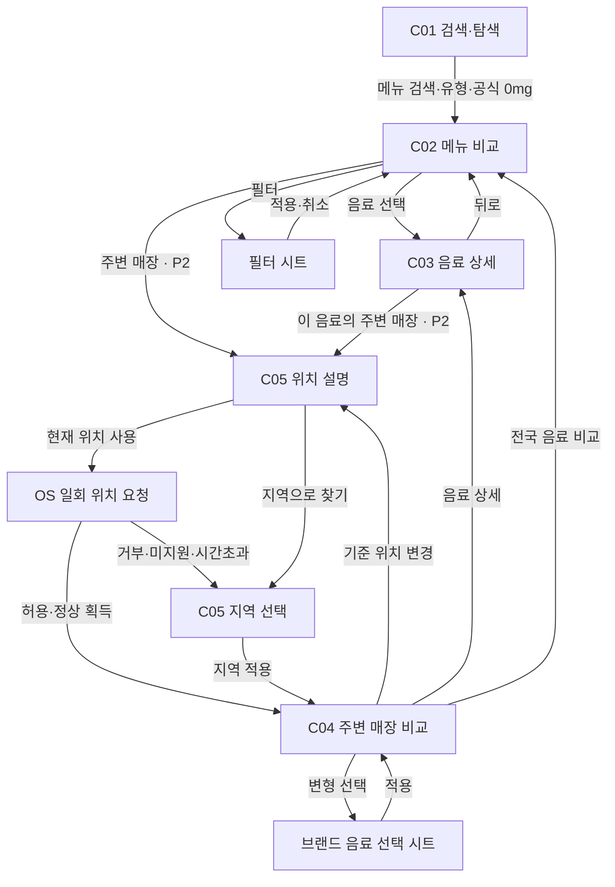

# 카페 음료 비교 화면설계서

작성일: 2026-10-21. 상태: 검토 초안. [기획안](plan.md)의 제안 계약을 구체화한다.

**[제안]** 이하 화면·크기·상호작용·URL은 신규 설계다. 현재 구현된 화면이라는 뜻이 아니다. **[확인]** 현재 코드는 `CafePage.tsx`의 검색·표·브랜드 분할 화면이며 상세·주변 화면은 없다. 근거: `portal-fe/src/pages/rank/CafePage.tsx`.

## 1. 화면 목록과 흐름

| ID | 단계 | 화면 | 주 과업 |
|---|---|---|---|
| C01 | P1 | 검색·탐색 첫 화면 | 메뉴명·유형 또는 카페인 상태로 탐색 시작 |
| C02 | P1 | 메뉴 비교 | 같은 유형의 브랜드별 변형을 3수치로 비교 |
| C03 | P1 | 음료 상세 | 한 변형의 제공량·영양·원문 검증 |
| C04 | P2 | 주변 매장 비교 | 주변 매장과 선택 음료 수치 연결 |
| C05 | P2 | 위치 설명·지역 대체 | 일회 위치 동의 또는 지역 선택 |

필터 시트는 C02의 보조 상태다. 브랜드별 변형 선택 시트는 C04의 보조 상태다. 별도 목적지 페이지로 늘리지 않는다.



## 2. 공통 레이아웃·가독성 계약

### 2.1 크기와 밀도

**[제안]** 기본 검수 뷰포트는 모바일 360×800, 데스크톱 1280×800이다. ASCII는 구조도이며 픽셀 렌더 결과가 아니다. 360px에서 좌우 `{spacing.4}` 여백, 콘텐츠 폭 328px을 사용한다. 데스크톱은 같은 세로 목록 구조를 유지하고 본문 최대 960px로 제한한다. `DESIGN.md`의 content 최대 1280 안에서 비교 표의 폭만 제한하는 제안이다.

| 요소 | 상한·규칙 |
|---|---|
| 첫 화면 | 주 행동 1개, 바로가기 유형 6개까지, 부가 설명 2줄까지 |
| 비교 상단 | 검색 1행, 유형·필터 1행, 기준 토글·정렬 1행, 요약 2줄까지 |
| 비교 한 행 | 메뉴 식별 최대 2줄, 온도·사이즈·용량 1줄, 핵심 수치 3개, 상태 보조 1줄 |
| 페이지 | 기본 20개 변형 또는 매장. 무한 스크롤 금지. 명시적 이전·다음 |
| 초기 360×800 결과 영역 | 완전한 비교 행 2개 이상을 목표로 한다. 제목·필터 때문에 첫 행이 접히면 수용 실패 |
| 초기 1280×800 결과 영역 | 최대 6행을 배치한다. 화면에 맞추려고 폰트를 줄이지 않는다 |
| 상세 | 주요 지표 3개, 메타 4묶음. 추가 영양성분·원천 메모는 접기 |
| 필터 시트 | 본문 최대 화면 높이 80%, 하단 취소·적용 고정. 콘텐츠만 세로 스크롤 |

확대·큰 글꼴에서는 행 수 목표보다 정보 보존을 우선한다. 페이지 가로 넘침과 중첩 가로 스크롤은 허용하지 않는다. 긴 메뉴명은 줄바꿈한다. 자르기가 필요하면 전체 메뉴명을 접근성 이름과 상세에 제공한다.

### 2.2 숫자·단위·강조

- 수치는 `tabular-nums`, 우측 정렬, 같은 너비의 3열이다. 메뉴·브랜드명은 좌측 정렬한다. 데스크톱도 같은 열 순서를 쓴다.
- 열 순서는 당류→카페인→열량으로 고정한다. 정렬 지표가 바뀌어도 열 위치는 바꾸지 않는다.
- 기본은 공식 1회 제공량이다. ‘100ml당’ 선택 시 3지표가 함께 바뀐다. 당류 g/100ml·카페인 mg/100ml·열량 kcal/100ml를 머리글과 접근성 이름에 쓴다.
- 화면 상단에 기준을 항상 표시한다. 각 행은 g·mg·kcal를 생략하지 않는다. 100ml 모드에서는 머리글에 공통 분모를, 각 셀에는 분자 단위를 표시한다.
- 소수는 최대 1자리, 불필요한 .0은 제거한다. 양수가 0으로 반올림되면 ‘<0.1’이다. 원값·반올림 전 계산으로 정렬한다. 상세 펼침에서 원래 공개값을 제공한다.
- 공식 0과 null은 구분한다. ‘미공개’·‘수치 미확정’·‘산출 불가’는 대시나 0 대신 텍스트를 쓴다.
- 선택한 정렬 지표만 semibold로 강조한다. 작은 숫자를 녹색, 큰 숫자를 빨강으로 칠하지 않는다. 건강 우열·종합점수·금은동 순위를 만들지 않는다.
- ‘최저’ 표시는 기본 범위에서 사용하지 않는다. 페이지·용량 미표시·변형 선택으로 비교 범위가 달라지기 때문이다.
- 같은 브랜드 변형은 개별 행으로 유지한다. 다른 브랜드 사이즈 S·Tall·기본을 동일 용량으로 간주하지 않는다.

### 2.3 토큰·접근성

현재 카페는 `useHeritageSurface()`를 사용한다. **[제안]** 이 표면을 유지한다. dark-trading의 profit/loss·quote 색을 영양값에 전용하지 않는다. 근거: `CafePage.tsx`, `DESIGN.md` §12·§2.

| 역할 | 토큰·표현 |
|---|---|
| 페이지·행·hover | `--ko-surface-0`, `--ko-surface-1`, `--ko-surface-2` |
| 수치·메뉴·설명 | `--ko-text-primary`, `--ko-text-secondary`. 미공개도 읽어야 할 정보이므로 disabled 색 금지 |
| 구획선 | `--ko-border-subtle`, `--ko-border-default`. 표 세로 격자 금지 |
| 주 행동 1개 | `--ko-accent-primary`, `.kh-button` |
| 링크·선택 설명 | `--ko-accent-text`. 다크 청자 원색을 작은 글씨에 직접 쓰지 않는다 |
| 키보드 포커스 | `--ko-focus-ring`, `--ko-focus-ring-offset` |
| 공간·형태 | `--ko-space-2/3/4/6`, `--kh-radius`. 장식 그림자·그래디언트·중첩 카드 금지 |
| 서체·크기 | `DESIGN.md`의 typography.family, base 16px 본문, sm 14px 메타, 2xl 24px 제목. 고정 rem 스케일. 숫자 20px, 단위·열 제목 14px 이상 |
| 모션 | `DESIGN.md` motion.normal. reduced-motion에서는 0ms. 로딩은 `.kh-skeleton`, shimmer 금지 |

라이트·다크 모두 일반 텍스트 대비 4.5:1 이상을 확인한다. 모든 조작 타깃은 44×44px 이상이다. 체크박스는 라벨 전체가 타깃이다. 선택 상태는 글자·체크·aria-pressed로도 전달한다. 출처: `DESIGN.md`, `docs/conventions/frontend-design.md`, `docs/standards/design-md.md`.

비교 목록은 시각적으로 행이더라도 의미 있는 table 또는 동등한 접근성 구조를 유지한다. 모바일에서 같은 데이터 DOM을 재배치한다. 브랜드·메뉴·당류·카페인·열량을 묶어 읽는다. 시트는 focus trap·Escape·닫기 후 원래 버튼 포커스 복귀를 제공한다. 결과 수만 aria-live=polite로 알리고 전체 목록을 반복 낭독하지 않는다.

## 3. C01 — 검색·탐색 첫 화면

### 목적과 구성

메뉴명·유형·카페인 상태 중 하나로 시작한다. 숫자 많은 표를 빈 검색 상태에 바로 펼치지 않는다. 검색 입력, 검색 버튼, 유형 6개, 공식 0mg·디카페인 바로가기, 출처 요약으로 구성한다. P2 전에는 주변 버튼을 표시하지 않는다.

### 모바일 360px

```text
┌──────────────────────────────┐
│ 랭킹                    테마 │
│ 카페 음료 비교               │
│ 공식 기본 레시피 기준        │
│ [메뉴명 입력               ] │
│ [          검색            ] │
│ 유형으로 비교                │
│ [바닐라라떼] [아메리카노]    │
│ [라떼]       [콜드브루]      │
│ [말차·녹차]  [전체 유형 ▾]   │
│ [공식 0mg]   [디카페인]      │
│ 디카페인은 0mg와 다릅니다    │
│ ──────────────────────────── │
│ 공식 영양정보 · 출처 안내 >  │
│ 매장 판매·가격 정보는 미제공 │
└──────────────────────────────┘
```

### 데스크톱 1280px

```text
┌────────────────────────────────────────────────────────────────────┐
│ 랭킹                                                          테마 │
│        카페 음료 비교                                              │
│        공식 기본 레시피 기준                                        │
│        [메뉴명 입력                                  ] [검색]      │
│        유형: [바닐라라떼] [아메리카노] [라떼] [콜드브루]            │
│              [말차·녹차라떼] [전체 유형 ▾]                           │
│        [공식 0mg] [디카페인]  디카페인은 0mg와 다릅니다              │
│        ────────────────────────────────────────────────────        │
│        공식 영양정보 · 출처 안내 / 매장 판매·가격 정보 미제공       │
└────────────────────────────────────────────────────────────────────┘
```

### 상태·인터랙션·URL

| 상태 | 표시·조작 |
|---|---|
| 정상 | 입력 초안은 메모리에 둔다. Enter·검색 제출에서 C02로 이동한다 |
| 로딩 | 유형 영역만 고정 높이 skeleton. 검색은 사용 가능 |
| 빈 유형 목록 | ‘유형 정보가 없습니다’. 메뉴 검색 유지 |
| groups·brands 오류 | ‘유형을 불러오지 못했습니다’와 재시도. 음료 API까지 실패한 것으로 처리하지 않는다 |
| 빈 검색 제출 | 전체 음료 탐색 C02로 이동한다. 무작위 추천은 만들지 않는다 |
| 위치 거부 | 이 화면에서는 위치 요청이 없다. 과거 거부 이력으로 경고를 띄우지 않는다 |

URL은 `/cafe`다. 입력 중 q를 쓰지 않는다. 유형 선택은 `/cafe?group=바닐라라떼`로 이동한다. 공식 0mg는 `?caffeineStatus=ZERO`, 디카페인은 `?caffeineStatus=DECAF`다. P1 새 API 계약을 전제로 한다. 과거 `caffeine=none`과 구분한다.

## 4. C02 — 메뉴 비교

### 목적과 구성

같은 유형의 여러 브랜드 음료를 한 축에서 비교한다. 모든 변형을 유지한다. 결과 제목에는 유형, 헤더에는 현재 조건·총 행 수를 표시한다. 출처 원문·추가 영양은 상세로 옮긴다.

아래 수치는 **실제 로컬 원천 예시**다. 순위·화면 전체 결과를 뜻하지 않는다. 컴포즈 `I-바닐라라떼`, 메가 `바닐라라떼/ICE`, 빽다방 `바닐라라떼(ICED)`를 사용했다. 출처: `ranking/ingest/data/cafe/drinks.{compose,mega,paik}.jsonl`. 표시값은 원천을 최대 소수 1자리로 반올림했다.

### 모바일 360px

```text
┌──────────────────────────────┐
│ < 탐색     바닐라라떼   테마 │
│ [바닐라라떼              ⌕] │
│ [유형 ▾] [ICE ×] [필터 1]   │
│ [1회 제공량 ● | 100ml당 ○]  │
│ 정렬 [당류 낮은 순 ▾]       │
│ 현재 20행 / 전체 N행        │
│ 메뉴명 기반 유형·용량 다름  │
│ ──────────────────────────── │
│ 컴포즈 · I-바닐라라떼     > │
│ ICE · 사이즈 미표시 · 591ml │
│     당류    카페인     열량  │
│   15.2 g  247.8 mg 198.4 kcal│
│ ──────────────────────────── │
│ 메가 · 바닐라라떼         > │
│ ICE · 사이즈 미표시 · 591ml │
│   23.7 g  195.1 mg 239.2 kcal│
│ ──────────────────────────── │
│ [이전]  1 페이지  [다음]    │
│ [주변 매장 비교 · P2]       │
└──────────────────────────────┘
```

열 머리글은 목록 상단에 고정한다. 각 행의 접근성 이름에는 지표명·단위를 포함한다. ‘미공개’가 있으면 그 셀을 2줄까지 허용한다. 영양 숫자 폭이 모자라면 단위를 숫자 아래로 내려 3열 정렬을 유지한다.

### 데스크톱 1280px

```text
┌────────────────────────────────────────────────────────────────────┐
│ 랭킹 > 카페 > 바닐라라떼                                     테마 │
│ [메뉴 검색                         ] [유형 ▾] [ICE ×] [필터 1]    │
│ [1회 제공량 ● | 100ml당 ○]             정렬 [당류 낮은 순 ▾]      │
│ 현재 20행 / 전체 N행 · 메뉴명 기반 유형 · 브랜드별 제공량 다름    │
│ ────────────────────────────────────────────────────────────────── │
│ 브랜드 / 메뉴 / 변형                  당류     카페인       열량  │
│ 컴포즈 I-바닐라라떼                 15.2 g   247.8 mg  198.4 kcal│
│ ICE · 사이즈 미표시 · 591ml                                    >  │
│ 메가 바닐라라떼                     23.7 g   195.1 mg  239.2 kcal│
│ ICE · 사이즈 미표시 · 591ml                                    >  │
│ 빽다방 바닐라라떼(ICED)              29 g      156 mg    372 kcal│
│ ICE · 사이즈 미표시 · 660ml                                    >  │
│ ────────────────────────────────────────────────────────────────── │
│ [이전] 1 페이지 [다음]                         [주변 매장 · P2]   │
└────────────────────────────────────────────────────────────────────┘
```

### 필터 시트

모바일은 바텀시트, 데스크톱은 같은 필드의 대화상자다. 영역 순서는 온도→브랜드→카페인 상태→1회량 상한이다. 브랜드 목록은 복수 체크다. 현재 총 브랜드 행 수는 접힌 상태에서 나열하지 않는다.

```text
┌──────────────────────────────┐
│ 필터                    닫기 │
│ 온도 [전체] [HOT] [ICE]      │
│ 브랜드 [전체 해제]          │
│ □ 이디야  □ 투썸  □ 빽다방 │
│ ... 승인된 9브랜드           │
│ 카페인 상태                 │
│ □ 공식 0mg  □ 디카페인      │
│ □ 수치 공개 □ 미공개        │
│ 1회 제공량 기준 상한        │
│ 당류 [   ] g 카페인 [   ] mg│
│ 미공개·수치 미확정은 제외   │
│ [초기화] [취소] [적용]      │
└──────────────────────────────┘
```

### 상태

| 상태 | 표시·복구 |
|---|---|
| 첫 로딩 | 3행 고정 높이 skeleton, aria-busy. 결과 수를 0개로 먼저 표시하지 않는다 |
| 조건 변경 로딩 | 이전 결과는 ‘갱신 중’으로 표시하고 선택 잠금. 이전 수치를 새 조건의 결과처럼 쓰지 않는다 |
| 빈 결과 | ‘조건에 맞는 음료가 없습니다’. 선택 조건 요약·필터 초기화·유형 해제 제공 |
| 음료 오류 | 오류 영역·재시도. 0개·페이지 nav와 배타 표시. 입력 조건은 보존 |
| 메타 오류 | 유형·브랜드 메타만 재시도. 이미 로드된 비교는 유지 |
| 100ml 전부 산출 불가 | ‘공개 용량이 없어 100ml 비교 불가’. 1회량 복귀. 행을 삭제하지 않는다 |
| 일부 산출 불가 | 계산 가능 수·산출 불가 수를 현재 페이지 기준으로 명시. 전량 집계라고 하지 않는다 |
| 기타 | 제목 ‘기타·유형 미분류’. ‘서로 같은 메뉴를 뜻하지 않음’ 표시 |
| 위치 거부 | 비교는 정상 사용. P2 주변 버튼에서 C05 대체 제공 |

### 인터랙션과 URL

- 검색 제출·유형·필터 적용·기준·정렬 변경은 page=0으로 이동한다. 필터 시트 초안 변경에는 요청·URL 갱신이 없다.
- 기본 size는 20이다. 구형 size=50 링크는 유지하되 한 화면에 50개를 밀어 넣지 않는다. 행 높이는 동일하고 페이지가 길어진다.
- 100ml 전환은 서버 정렬을 다시 요청한다. 현재 페이지 안에서만 재정렬하지 않는다. sugarPer100ml 구형 sort는 100ml·당류로 정규화한다.
- 행은 C03으로 이동한다. 뒤로가기 시 조건·페이지·스크롤·선택 행 포커스를 복원한다. URL에 스크롤 좌표를 넣지 않는다.
- 필터 적용은 history push, 초안과 비정상 파라미터 보정은 replace다. 페이지 이동은 push다.

예시 URL: `/cafe?group=바닐라라떼&temperature=ICE&basis=serving&sort=sugar&page=0&size=20`.

허용 상태는 q·반복 brand·group·temperature·반복 caffeineStatus·maxSugar·maxCaffeine·basis·sort·page·size다. 기본값은 공유 URL에서 생략 가능하다. q는 최대 120자다. 기존 `cafeUrl.ts`와 같은 허용목록 검증을 유지하고 새 필드만 명시 확장한다. 원치 않는 좌표 파라미터는 생성·재공유하지 않는다. 이 URL은 noindex다. 근거: `portal-fe/src/pages/rank/cafeUrl.ts`, [plan.md §8·§9](plan.md).

## 5. C03 — 음료 상세

### 목적과 구성

공식 한 변형을 확인한다. 온도·사이즈·용량·카페인 상태를 제목 가까이 둔다. 3수치, 제공량 원문, 가격 미제공, 공식 원문·확인일, 추가 영양성분·notes를 제공한다.

### 모바일 360px

```text
┌──────────────────────────────┐
│ < 비교로                     │
│ 컴포즈커피                   │
│ I-바닐라라떼                │
│ ICE · 사이즈 미표시 · 591ml  │
│ [1회 제공량 ● | 100ml당 ○]  │
│     당류    카페인     열량  │
│   15.2 g  247.8 mg 198.4 kcal│
│ 카페인: 수치 공개            │
│ ──────────────────────────── │
│ 제공량  [servingBasis 원문]  │
│ 가격    정보 미제공          │
│ 유형    바닐라라떼·규칙 분류│
│ 확인일  2026-10-20           │
│ [공식 영양정보 원문 ↗]      │
│ [추가 영양성분 ▾]           │
│ [원천 메모 ▾]               │
│ 기본 레시피·판매 여부 미확인│
│ [이 음료의 주변 매장 · P2]  │
└──────────────────────────────┘
```

### 데스크톱 1280px

```text
┌────────────────────────────────────────────────────────────────────┐
│ < 비교로                                                           │
│        컴포즈커피 / I-바닐라라떼                                   │
│        ICE · 사이즈 미표시 · 591ml                                 │
│        [1회 제공량 ● | 100ml당 ○]                                 │
│                 당류           카페인              열량           │
│               15.2 g         247.8 mg          198.4 kcal          │
│        ────────────────────────────────────────────────────        │
│        제공량 [servingBasis 원문]    가격 정보 미제공              │
│        유형 바닐라라떼·메뉴명 규칙   확인일 2026-10-20             │
│        [공식 영양정보 원문 ↗] [추가 영양성분 ▾] [원천 메모 ▾]     │
│        브랜드 기본 레시피 · 매장 판매·커스텀 변경 미확인           │
│        [이 음료의 주변 매장 · P2]                                 │
└────────────────────────────────────────────────────────────────────┘
```

수치·날짜 출처는 C02와 같은 컴포즈 원천 행이다. servingBasis는 실제 값만 출력한다. 원문이 없으면 ‘제공량 설명 미표시’다. 다른 온도·사이즈를 상세 안에서 임의로 전환하지 않는다. ‘같은 브랜드 다른 변형’ 링크를 명시적으로 선택한다.

### 상태·인터랙션·URL

| 상태 | 표시·복구 |
|---|---|
| 로딩 | 제목·3수치 자리 skeleton. 임시 0 표시 금지 |
| 404·삭제 메뉴 | ‘현재 자료에서 이 음료를 찾을 수 없습니다’. 유형 재검색·탐색 첫 화면 링크 |
| 네트워크 오류 | 재시도·비교로 돌아가기. 404와 구분 |
| 카페인 미공개·미확정 | 같은 용어로 표시. notes는 원문 그대로 접힌 영역에서 확인 |
| 용량 미표시 | 100ml 선택 유지 가능, 각 값은 산출 불가. 1회량 복귀 동작 제공 |
| 위치 거부 | 영양 상세와 원문 확인은 정상 동작. 주변 버튼은 C05로 이동 |

URL은 `/cafe/drinks/:drinkKey?basis=serving`이다. C02와 동일 basis를 전달하고 기본값은 생략한다. 상세 직접 진입은 비교 링크 대신 탐색 링크를 제공한다. P2에서 진입한 경우 뒤로가기로 C04의 메모리 상태를 복원하며 좌표를 history에 넣지 않는다. 상세 키는 API 선행 조건이며 현재 응답 필드가 아니다. 출처: `ranking/feature/src/main/kotlin/com/kgd/ranking/application/cafe/dto/CafeDrinkDtos.kt`.

## 6. C04 — 주변 매장 비교

### 목적과 구성

반경 안의 **브랜드 매장**과 **선택 음료의 공식 수치**를 함께 본다. 지도 대신 목록을 사용한다. 매장 판매·재고·가격·영업중은 확인하지 않는다. 이 한계를 목록 상단과 상세 진입에 표시한다.

아래 매장명·거리는 **설명용 가상값**이다. 실제 매장 존재·거리·판매를 주장하지 않는다. 음료 수치는 C02의 원천 예시를 사용한다.

### 모바일 360px

```text
┌──────────────────────────────┐
│ < 전국 비교      주변 매장  │
│ 현재 위치 기준 [위치 변경]  │
│ 반경 [1km ▾] [조건]         │
│ 바닐라라떼 · ICE            │
│ [1회 제공량 ● | 100ml당 ○]  │
│ 정렬 [가까운 순 ▾]          │
│ 매장 N곳 · 브랜드 M개       │
│ 브랜드 기본 레시피          │
│ 매장별 판매 여부는 미확인   │
│ ──────────────────────────── │
│ 가상 컴포즈 A점 · 직선 350m │
│ I-바닐라라떼 [변형 변경]    │
│ ICE · 사이즈 미표시 · 591ml │
│   15.2 g  247.8 mg 198.4 kcal│
│ [음료 상세]  주소 펼치기 ▾  │
│ ──────────────────────────── │
│ 가상 메가 B점 · 직선 620m   │
│ [비교할 음료 선택]          │
│ 여러 변형 중 선택 필요     │
│ ──────────────────────────── │
│ [이전] 1 페이지 [다음]      │
│ 매장 자료 기준일 YYYY-MM-DD │
└──────────────────────────────┘
```

매장 한 행은 최대 매장명 2줄·메뉴 2줄·변형 1줄·3수치·안내 1줄이다. 이 화면의 상단 정보가 길어지면 전국 비교 링크·조건 상세를 접고 초기 뷰포트에 완전한 매장 행 1개 이상을 확보한다. ‘매장 자료 기준일’과 ‘영양 확인일’을 합치지 않는다.

### 데스크톱 1280px

```text
┌────────────────────────────────────────────────────────────────────┐
│ < 전국 음료 비교                            주변 매장 비교         │
│ 현재 위치 기준 [변경] 반경 [1km ▾] 바닐라라떼·ICE [조건]           │
│ [1회 제공량 ● | 100ml당 ○]                  [가까운 순 ▾]          │
│ 매장 N곳 · 브랜드 M개 / 브랜드 기본 레시피 · 매장 판매 미확인      │
│ ────────────────────────────────────────────────────────────────── │
│ 매장·거리 / 선택 음료                  당류     카페인       열량 │
│ 가상 컴포즈 A점 · 직선 350m           15.2 g   247.8 mg 198.4 kcal│
│ I-바닐라라떼 · ICE · 591ml        [변형 변경] [음료 상세]          │
│ 가상 메가 B점 · 직선 620m             비교할 음료 선택 필요        │
│ [해당 브랜드 변형 선택]                                           │
│ ────────────────────────────────────────────────────────────────── │
│ [이전] 1 페이지 [다음] / 매장 기준일·수집일·자료 범위 펼치기       │
└────────────────────────────────────────────────────────────────────┘
```

### 상태

| 상태 | 표시·복구 |
|---|---|
| 위치 없음·직접 URL 진입 | C05 설명으로 이동. 자동 OS 팝업 금지 |
| 로딩 | 이전 반경 결과를 새 결과로 노출하지 않는다. skeleton과 ‘주변 자료 확인 중’ |
| 매장 0곳 | ‘이 반경의 등록된 비교 가능 매장이 없습니다’. 반경 확대·지역 변경·전국 비교 제공 |
| 지역 미지원 | ‘아직 이 지역의 매장 자료를 제공하지 않습니다’. 매장 0곳과 구분 |
| 매장은 있으나 해당 유형 없음 | ‘매장은 있으나 비교할 영양 자료가 없습니다’. 유형 변경·전국 비교 |
| 브랜드 변형 미선택 | 수치 자리에 ‘음료 선택 필요’. 0·최저값을 대신 쓰지 않는다 |
| 일부 매장 매핑 제외 | coverage에 ‘브랜드 매핑이 확인된 자료만 표시’와 범위 설명. 제외 매장 수를 모르면 수치를 만들지 않는다 |
| 위치 정확도 낮음 | ‘위치가 넓게 추정됨’. 직선거리 안내·지역 선택 제공 |
| 조회 오류·투영본 미준비 | 오류와 재시도·전국 비교. 전국 결과를 주변 목록에 대체 표시 금지 |
| 자료 45일 초과 | 지연 배너와 실제 기준일. 90일 초과는 주변 제공 중단·전국 비교 |
| 권한 거부·미지원 | C05 지역 대체. 기존 전국 음료 비교 조건 보존 |

### 인터랙션과 URL

- C03에서 진입하면 해당 drinkKey를 선택값으로 전달한다. C02에서 진입하면 브랜드별 변형을 선택한다. 한 변형만 있는 브랜드는 명시적으로 자동 선택을 알린다.
- 한 브랜드의 선택을 바꾸면 그 브랜드의 모든 지점 행에 동일하게 반영한다. 지점별 영양값을 따로 계산하지 않는다.
- 기본 정렬은 직선거리다. 수치순 정렬 시 미선택·null은 뒤로 보낸다. 사용자가 고른 변형 기준임을 표기한다.
- 반경·브랜드·유형·변형 변경은 동일 메모리 위치로 POST 검색한다. 위치를 다시 요청하지 않는다. 자동 반경 확대도 하지 않는다.
- 공유는 ‘전국 음료 비교 조건 공유’만 제공한다. 현재 위치·선택 지역·매장 거리는 포함하지 않는다.

URL은 `/cafe/nearby?group=바닐라라떼&temperature=ICE&basis=serving&sort=distance&radius=1`이다. AREA 선택 시 공개 법정동 `areaCode`만 선택적으로 추가할 수 있다. CURRENT 좌표·정확도·좌표로 만든 토큰은 URL·hash·history·저장소에 넣지 않는다. 페이지·브랜드별 선택키는 클라이언트 메모리 상태로 유지한다. 새로고침은 위치 설명부터 다시 시작한다. AREA URL은 새로고침 시 해당 지역 조건을 복원한다. 이 URL은 noindex다.

## 7. C05 — 위치 설명·지역 대체

### 목적과 구성

위치 사용의 목적과 보존 범위를 먼저 설명한다. 동의하지 않아도 같은 과업을 지역 중심 기준으로 수행한다. 거부를 오류로 몰거나 OS 설정 변경을 강요하지 않는다.

### 모바일 360px

```text
┌──────────────────────────────┐
│ < 비교로     기준 위치 선택 │
│ 주변 브랜드 매장을 찾습니다 │
│ 위치는 이번 검색에만 사용   │
│ 저장·공유하지 않습니다      │
│ [     현재 위치 사용       ]│
│ 또는 지역으로 찾기          │
│ 시도   [선택 ▾]             │
│ 시군구 [선택 ▾]             │
│ 선택 지역 중심 반경 1km     │
│ 실제 현재 위치와 다릅니다   │
│ [지역 적용]                 │
│ [위치 없이 전국 음료 비교]  │
│ ──────────────────────────── │
│ 거부 시: 위치 접근이        │
│ 허용되지 않았습니다        │
│ 지역을 선택해 계속할 수 있음│
└──────────────────────────────┘
```

### 데스크톱 1280px

```text
┌────────────────────────────────────────────────────────────────────┐
│ < 비교로                                                           │
│        기준 위치 선택                                              │
│        주변 브랜드 매장 검색에 이번 위치만 사용합니다              │
│        좌표는 저장·공유하지 않습니다                               │
│        [현재 위치 사용]                                            │
│        ────────────────────────────────────────────────────        │
│        또는 지역으로 찾기                                          │
│        시도 [선택 ▾]   시군구 [선택 ▾]  [지역 적용]                │
│        선택 지역 중심 반경 1km · 실제 현재 위치와 다를 수 있음      │
│        [위치 없이 전국 음료 비교]                                 │
│        상태 안내 영역: 거부 / 미지원 / 시간초과                    │
└────────────────────────────────────────────────────────────────────┘
```

‘저장·공유하지 않음’ 문구는 전 계층 좌표 비보존 검증을 통과한 뒤 사용한다. 설계만으로 현재 시스템이 이를 보장한다고 주장하지 않는다. 근거: [plan.md §7](plan.md).

### 상태·인터랙션

| 상태 | 문구·행동 |
|---|---|
| 최초 | 현재 위치·지역 선택을 모두 제공. 버튼 클릭 전 OS 권한 요청 없음 |
| 획득 중 | ‘위치 확인 중’. 중복 클릭 잠금. 취소·지역 선택 가능. 늦게 도착한 응답은 취소 후 무시 |
| 허용 | 정확도 확인 뒤 C04로 이동. 지속 위치 감시 없음 |
| 거부 | ‘위치 접근이 허용되지 않았습니다’. 지역 선택에 포커스 이동. 자동 재요청 없음 |
| 미지원·보안 컨텍스트 제한 | ‘이 환경에서 현재 위치를 사용할 수 없습니다’. 지역 선택 유지 |
| 시간초과·획득 실패 | ‘위치를 확인하지 못했습니다’. 재시도·지역 선택 제공 |
| 지역 목록 로딩 | 종속 select 잠금, 로딩 설명. 시도 변경 시 이전 시군구 선택 해제 |
| 지역 목록 오류 | ‘지역 목록을 불러오지 못했습니다’. 재시도·전국 비교. 지도 외부 검색으로 우회하지 않는다 |
| 지원 지역 없음 | ‘아직 주변 비교를 제공하는 지역이 없습니다’. P2 노출 상태 점검·전국 비교 |
| 선택 완료 | 지역 적용에서 C04. 위치 미동의 상태 그대로 사용 가능 |

URL은 `/cafe/location?group=바닐라라떼`이며 q·group·brand·temperature·basis 등 허용된 비교 조건만 이어받는다. 거부 이유·OS 권한 상태는 메모리에만 둔다. 지역 선택 초안은 URL에 쓰지 않고 적용 후 C04에 areaCode를 전달한다. 이탈 시 위치 획득과 초안은 폐기한다. 미지원 지역 입력을 임의의 전국 중심 좌표로 바꾸지 않는다.

## 8. 공통 URL·상태 인수인계 표

| 상태 | URL | 메모리 | 서버 영속화 |
|---|---|---|---|
| 검색·유형·브랜드·영양 조건·basis·정렬 | C02 허용 필드 | 입력 초안 | 없음 |
| 상세 drinkKey | 상세 경로 | 복귀 포커스 | 기존 영양 데이터의 안정키만 |
| 현재 사용자 좌표·정확도 | 금지 | C04 활성 흐름 동안만 | 금지 |
| 선택 지역 | 적용 후 areaCode 허용 | 선택 초안 | 개인 선택 기록 없음 |
| 매장별 음료 선택 | 공유 URL에 포함하지 않음 | 브랜드당 1키 | 없음 |
| 권한 거부·타임아웃 | 금지 | 해당 화면 상태 | 없음 |
| 결과 로딩·오류·시트 열림 | 금지 | 컴포넌트 상태 | 좌표·본문 없는 집계만 검토 |

분석 이벤트는 과업 시작·완료·오류 코드·기준 토글 정도만 허용한다. 좌표·정확도·원문 q·매장 거리·식별 가능한 위치 조합을 이벤트에 싣지 않는다. 사용자 실험 시간은 동의한 평가 세션에서 측정한다.

## 9. 구현 전 검수 시나리오

아래는 **[제안] 검수 목록**이며 실행 결과가 아니다.

1. 지정된 구형 바닐라라떼 URL을 열어 C02가 복원되는지 확인한다. 페이지 50행 조건과 결과 전체 범위를 혼동하는 문구가 없어야 한다.
2. ICE·일반·디카페인·대용량 변형을 섞어 당류·카페인·열량 3축과 식별 정보가 유지되는지 확인한다.
3. 공식 0·DECAF 수치 있음·DECAF null·DISCLOSED null·UNDISCLOSED를 각각 검사한다. 0mg로 합치는 사례가 없어야 한다.
4. 100ml 토글로 용량 있는 행의 3수치를 검산한다. 용량 없는 던킨 예시는 산출 불가로 남아야 한다. 서버 전체 정렬과 페이지 경계를 확인한다.
5. 로딩·오류·빈 결과를 전환한다. 오류와 0개·페이지 nav가 동시에 나타나지 않아야 한다.
6. 상세 직접 진입·메뉴 삭제·뒤로가기를 확인한다. 비교 조건·스크롤·키보드 포커스가 복원돼야 한다.
7. 모바일 360×800·데스크톱 1280×800·200% 확대·라이트·다크를 검수한다. 숫자·단위 잘림, 가로 넘침, 색만으로 구분하는 상태가 없어야 한다.
8. 주변 최초 진입·거부·미지원·timeout·지역 선택·자료 없음·미지원 지역을 각각 통과한다. 전국 자료로 바꿔 보여주는 경우가 없어야 한다.
9. 같은 브랜드 두 가상 지점에 동일 음료 수치가 표시되고 판매 미확인 안내가 유지되는지 확인한다.
10. 위치 표식으로 브라우저 URL·공유·저장소와 서버 전 계층 로그·분석·캐시를 점검한다. 잔존 0건을 증거로 기록한다.

코드 구현·브라우저 시각 검수·사용자 평가·부하 검증은 이번 문서 작업에서 수행하지 않았다. 단계별 통과 기준은 [plan.md §4](plan.md)에 둔다.
